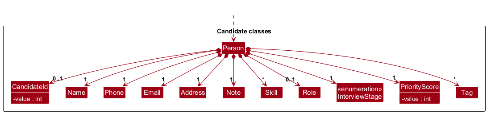
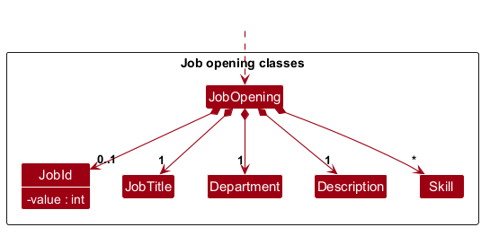
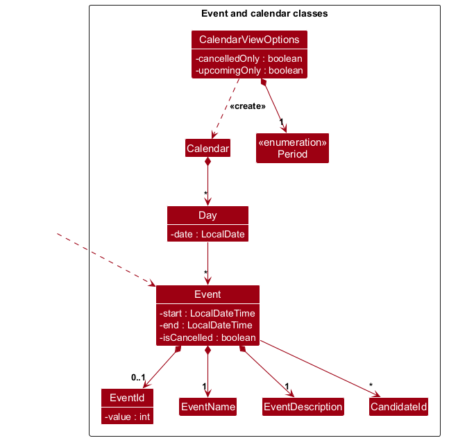
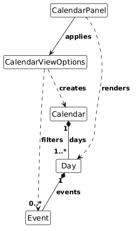

* Table of Contents
{:toc}

--------------------------------------------------------------------------------------------------------------------

## **Acknowledgements**

* HireBase is based on the [AddressBook-Level3](https://github.com/se-edu/addressbook-level3) project created by the [SE-EDU initiative](https://se-education.org). The architecture, the command parsing classes, and the structure of the User Guide and this Developer Guide are adapted from it.
* Libraries used: [JavaFX](https://openjfx.io/), [Jackson](https://github.com/FasterXML/jackson), [JUnit5](https://github.com/junit-team/junit5)
* Diagrams are drawn with [PlantUML](https://plantuml.com/), using the styles from the SE-EDU AddressBook-Level3 `diagrams` folder.
* The checkstyle and Codecov setup follows the SE-EDU AddressBook-Level3 project.

--------------------------------------------------------------------------------------------------------------------

## **Setting up, getting started**

Refer to the guide [_Setting up and getting started_](SettingUp.md).

--------------------------------------------------------------------------------------------------------------------

## **Design**

<div markdown="span" class="alert alert-primary">

:bulb: **Tip:** The `.puml` files used to create diagrams are in `docs/diagrams`. Refer to the [_PlantUML Tutorial_ at se-edu/guides](https://se-education.org/guides/tutorials/plantUml.html) to learn how to create and edit diagrams.
</div>

### Architecture


The ***Architecture Diagram*** given above explains the high-level design of the App.

The following provides a quick overview of the main components and their interactions.

**Main components of the architecture**

**`Main`** (consisting of classes [`Main`](https://github.com/AY2627S1-CS2103T-T12-1/tp/tree/master/src/main/java/seedu/hirebase/Main.java) and [`MainApp`](https://github.com/AY2627S1-CS2103T-T12-1/tp/tree/master/src/main/java/seedu/hirebase/MainApp.java)) is in charge of the app launch and shut down.
* At app launch, it initializes the other components in the correct sequence, and connects them up with each other.
* At shut down, it shuts down the other components and invokes cleanup methods where necessary.

The bulk of the app's work is done by the following four components:

* [**`UI`**](#ui-component): The UI of the App.
* [**`Logic`**](#logic-component): The command executor.
* [**`Model`**](#model-component): Holds the data of the App in memory.
* [**`Storage`**](#storage-component): Reads data from, and writes data to, the hard disk.

[**`Commons`**](#common-classes) represents a collection of classes used by multiple other components.

**How the architecture components interact with each other**

The *Sequence Diagram* below shows how the components interact with each other for the scenario where the user issues the command `delete candidate 1`, which deletes the candidate whose
permanent candidate ID is `1`.


Each of the four main components (also shown in the diagram above),

* defines its *API* in an `interface` with the same name as the Component.
* provides its functionality through a concrete `{Component Name}Manager` class that implements the corresponding API interface.

For example, the `Logic` component defines its API in `Logic.java` and implements it in `LogicManager.java`. Other components interact with a component through its interface rather than its concrete class, preventing them from coupling to that component's implementation, as illustrated in the following partial class diagram.


The sections below give more details of each component.

### UI component

The **API** of this component is specified in [`Ui.java`](https://github.com/AY2627S1-CS2103T-T12-1/tp/tree/master/src/main/java/seedu/hirebase/ui/Ui.java)


This partial class diagram highlights the candidate list and calendar integration. `MainWindow` owns one
`CalendarPanel`, which extends `UiPart` and uses events and `CalendarViewOptions` from the Model component.
`MainWindow` passes the calendar's observable visible-event count to `StatusBarFooter`; the footer does not
hold a reference to the calendar panel. Other UI classes are omitted for readability.

The UI consists of a `MainWindow` and its parts, such as `CommandBox`, `ResultDisplay`, `PersonListPanel`,
`CalendarPanel` and `StatusBarFooter`. All of these, including `MainWindow`, inherit from the abstract `UiPart`
class, which captures common behavior among classes that represent visible GUI parts.

The `UI` component uses the JavaFX UI framework. The layouts of these UI parts are defined in matching `.fxml` files in `src/main/resources/view`. For example, [`MainWindow.fxml`](https://github.com/AY2627S1-CS2103T-T12-1/tp/tree/master/src/main/resources/view/MainWindow.fxml) specifies the layout of [`MainWindow`](https://github.com/AY2627S1-CS2103T-T12-1/tp/tree/master/src/main/java/seedu/hirebase/ui/MainWindow.java).

The `UI` component,

* executes user commands using the `Logic` component.
* listens for changes to `Model` data so that the UI can be updated with the modified data.
* keeps a reference to the `Logic` component, because the `UI` relies on the `Logic` to execute commands.
* depends on some classes in the `Model` component because it displays candidates, job openings and events from the model.

### Logic component

**API** : [`Logic.java`](https://github.com/AY2627S1-CS2103T-T12-1/tp/tree/master/src/main/java/seedu/hirebase/logic/Logic.java)

Here's a (partial) class diagram of the `Logic` component:


The sequence diagram below illustrates the interactions within the `Logic` component, taking `execute("delete candidate 1")` API call as an example.


<div markdown="span" class="alert alert-info">:information_source: **Note:** The lifeline for `DeleteCommandParser` should end at the destroy marker (X), but due to a limitation of PlantUML, it continues to the end of the diagram.
</div>

How the `Logic` component works:

1. When `Logic` is called upon to execute a command, the command is passed to an `HireBaseParser` object, which in turn creates a parser that matches the command (e.g., `DeleteCommandParser`) and uses it to parse the command.
1. This results in a `Command` object (more precisely, an object of one of its subclasses e.g., `DeleteCommand`) which is executed by the `LogicManager`.
1. The command can communicate with the `Model` when it is executed (e.g. to look up a candidate by their `CandidateId` and delete them).<br>
   Note that although this is shown as a single step in the diagram above for simplicity, the code can require several interactions between the command object and the `Model` to complete the operation.
1. The result of the command execution is encapsulated as a `CommandResult` object which is returned from `Logic`.

Here are the other classes in `Logic` (omitted from the class diagram above) that are used for parsing a user command:


How the parsing works:
* When called upon to parse a user command, the `HireBaseParser` class creates an `XYZCommandParser` (`XYZ` is a placeholder for the specific command name, e.g., `AddCommandParser`). The parser uses the other classes shown above to parse the user command and create an `XYZCommand` object (e.g., `AddCommand`). The `HireBaseParser` returns that object as a `Command` object.
* All `XYZCommandParser` classes, such as `AddCommandParser` and `DeleteCommandParser`, implement the `Parser` interface so they can be treated similarly where appropriate, for example during testing.

#### How `LogicManager` saves data

After a command that changes data, `LogicManager` writes the data file through `Storage`. It uses one of three patterns,
chosen by the type of command:

1. **Read-only commands** (`list jobs`, `view event` and `view calendar`) return their result without saving. A failed
   save can therefore never replace what the user asked to see with a save error.
1. **Save-before-publish commands** (`add job`, `edit job`, `delete job`, `add event`, `edit event`, `delete event`, and the candidate
   commands `add candidate`, `delete candidate`, `edit candidate`, `note` and `stage candidate`, which `accept candidate`
   and `reject candidate` extend) are first run on a `pending` copy of the model. `LogicManager` saves the copy, and only
   then changes the real model that the UI observes. If the command or the save fails, the real model, the filters, the
   ID counters and the data file are unchanged. The ways of changing the real model differ slightly: `add event`
   adds the exact event that was saved, so the ID in the app and in the file are the same (see
   [Add event feature](#add-event-feature)), while the other commands run again on the real model, which gives the same
   result because it holds the same data as the copy. The [`delete event` sequence diagram](#delete-event-feature)
   shows the replay pattern.
1. **All other commands** (for example `find`, `list candidates`, `clear` and `view candidate`) run on the real model, and
   the data file is saved afterwards.

### Model component
**API** : [`Model.java`](https://github.com/AY2627S1-CS2103T-T12-1/tp/tree/master/src/main/java/seedu/hirebase/model/Model.java)


The class diagram above shows the structure of the `Model` component. To keep each diagram readable, the details of
candidates, job openings, and events and calendars are shown in separate diagrams below.

The `Model` component,

* stores the HireBase data: candidates in `UniquePersonList`, job openings in `UniqueJobOpeningList`, and events in `UniqueEventList`.
* gives every candidate a permanent `CandidateId` when they are added, and keeps the `nextCandidateId` counter in `HireBase` so that an ID is never reused (see [Candidate ID](#candidate-id)).
* stores all calendar `Event` objects in a `UniqueEventList`, gives each new event a permanent `EventId` from the `nextEventId` counter, and finds the events that overlap a given event (see [Add event feature](#add-event-feature)).
* stores the `Person` objects selected by the current filter, such as search results, in a separate _filtered_ list. It exposes this list as an unmodifiable `ObservableList<Person>` that the UI can observe and bind to, so the UI updates when the list changes.
* stores a `UserPrefs` object that represents the user’s preferences (currently, just the GUI settings). This is exposed to the outside as a `ReadOnlyUserPrefs` object.
* stores job openings in `UniqueJobOpeningList`, and gives each a permanent `JobId` from the `nextJobId` counter in `HireBase`.
* provides the `Calendar`, `Day` and `CalendarViewOptions` classes in `seedu.hirebase.model.calendar`. They are built from the events when needed and are not stored in `HireBase` (see [Calendar view](#calendar-view)).
* does not depend on any of the other three components (as the `Model` represents data entities of the domain, they should make sense on their own without depending on other components)

**Candidate classes.** A `Person` is an immutable candidate. Its `CandidateId` is empty until `HireBase` adds the candidate, and its `PriorityScore` defaults to Low.



**Job opening classes.** A `JobOpening` is also immutable, and its `JobId` is empty until `HireBase` adds it.



**Event and calendar classes.** An `Event` starts and ends on the same day and refers to its candidates by `CandidateId` only, so deleting a candidate does not change any event. `CalendarViewOptions` builds a `Calendar`, which groups the matching events into `Day`s.



<div markdown="span" class="alert alert-info">:information_source: **Note:** The alternative, arguably more object-oriented, design below keeps a unique list of tags in `HireBase`, and each `Person` references tags from that list. This lets `HireBase` maintain one `Tag` object per unique tag instead of each `Person` holding its own `Tag` objects.<br>


</div>


### Storage component

**API** : [`Storage.java`](https://github.com/AY2627S1-CS2103T-T12-1/tp/tree/master/src/main/java/seedu/hirebase/storage/Storage.java)


The `Storage` component,
* can save both HireBase data and user preference data in JSON format, and read them back into corresponding objects.
* saves each candidate's `candidateId` in `JsonAdaptedPerson`, and the `nextCandidateId` counter in `JsonSerializableHireBase`, so that candidate IDs stay the same across restarts.
* saves each job opening in `JsonAdaptedJobOpening`, and the `nextJobId` counter in `JsonSerializableHireBase`, so that job IDs stay the same across restarts.
* saves each event in `JsonAdaptedEvent`, and the `nextEventId` counter in `JsonSerializableHireBase`, in the same data file as candidates and job openings.
* keeps a timestamped copy of a data file that cannot be loaded, so that the user's data is not lost when the app starts empty (see [Backing up an invalid data file](#backing-up-an-invalid-data-file)).
* is implemented by `StorageManager`, which delegates the actual JSON file access to `JsonHireBaseStorage` and `JsonUserPrefsStorage` (one class per data file).
* depends on some classes in the `Model` component (because the `Storage` component's job is to save/retrieve objects that belong to the `Model`)

### Common classes

Classes used by multiple components are in the `seedu.hirebase.commons` package.

--------------------------------------------------------------------------------------------------------------------

## **Implementation**

This section describes some noteworthy details on how certain features are implemented.

### Candidate ID

Every candidate has a permanent `CandidateId`, shown on their card as `#N` (e.g. `#1`). All commands that target an
existing candidate (`edit candidate`, `delete candidate`, `view candidate`, `note`, `stage candidate`,
`accept candidate` and `reject candidate`) identify the candidate by this ID instead of their position in the
displayed list.

#### Implementation

`CandidateId` is a small immutable value class in `seedu.hirebase.model.candidate` that wraps a positive `int`.
A `Person` holds at most one `CandidateId`. It is *not* part of `Person#equals(...)` or `Person#isSamePerson(...)`,
so comparing candidates (for example, the duplicate-email check) ignores their IDs.

**Assigning an ID.** The `Person` created by `AddCommandParser` has no ID yet. The ID is assigned by the model, in
`HireBase#addPerson(Person)`, so that the `Logic` component never needs to know which ID comes next. The sequence
diagram below shows what happens when `AddCommand` adds a new candidate.


1. `AddCommand` calls `Model#addPerson(toAdd)`, which `ModelManager` passes on to `HireBase#addPerson(toAdd)`.
1. `HireBase` sees that `toAdd` has no `CandidateId` yet, so it creates a new `CandidateId` from its `nextCandidateId` counter.
1. Because `Person` is immutable, `Person#withCandidateId(id)` returns a copy of `toAdd` that carries the new ID. This copy is the one stored in the `UniquePersonList`.
1. `HireBase` then increments `nextCandidateId`, and `ModelManager` resets the filter so that the new candidate is shown.

**Looking up a candidate by ID.** Commands resolve an ID with `ReadOnlyHireBase#getPersonByCandidateId(CandidateId)`,
which searches the *full* candidate list (not the filtered list) and returns an `Optional<Person>`. If the optional is
empty, the command throws a `CommandException` with `Messages#MESSAGE_CANDIDATE_ID_NOT_FOUND`. The `delete candidate`
flow in the [Logic component](#logic-component) and the [`view`](#view-candidate-feature) and
[`note`](#note-feature) features below all use this lookup.

**Keeping an ID when a candidate is edited.** `edit candidate`, `note` and `stage candidate` build a new `Person` and
call `Model#setPerson(target, editedPerson)`. These commands copy the original `CandidateId` into the edited `Person`.
As a safety net, `HireBase#setPerson(...)` also copies `target`'s ID into `editedPerson` if it has none.

**Never reusing an ID.** `nextCandidateId` only ever moves forward:

* Deleting a candidate does not change the counter, so their ID is retired.
* `clear` replaces the data through `HireBase#resetData(...)`, which keeps the larger of the current and new counters, so IDs used before `clear` are not given out again.
* Adding a candidate that already has an ID (e.g. when loading from storage) moves the counter past that ID.

**Saving and loading.** `JsonAdaptedPerson` stores each candidate's `candidateId`, and `JsonSerializableHireBase`
stores `nextCandidateId`, as shown in the [Storage component](#storage-component). When loading,
`JsonSerializableHireBase#toModelType()`:

* rejects the file if two candidates have the same `candidateId`, or if any ID or the counter is not a positive integer;
* reserves IDs up to the saved `nextCandidateId` via `HireBase#reserveCandidateIdsUpTo(int)`;
* gives candidates from older data files that have no `candidateId` new IDs in file order, starting after every stored ID.

#### Design considerations

**Aspect: How commands refer to a candidate**

* **Alternative 1 (current choice):** A permanent `CandidateId` assigned when the candidate is added.
  * Pros: The same ID always refers to the same candidate, even after a `find`, a deletion or a restart, so a recruiter can note down an ID and use it later.
  * Cons: Needs an extra field, a counter, and extra checks when loading the data file.
* **Alternative 2:** The candidate's position (index) in the displayed list, as in AddressBook-Level3.
  * Pros: Nothing extra to store or save.
  * Cons: The same number points to a different candidate after a `find` or a deletion, which makes it easy to edit or delete the wrong candidate.

**Aspect: Where the ID is assigned**

* **Alternative 1 (current choice):** In `HireBase#addPerson(Person)`.
  * Pros: `HireBase` owns the counter, so one place decides every new ID, and IDs stay unique however a candidate is added.
  * Cons: The `Person` passed to `addPerson` is not the same object that gets stored, so callers must not keep using it if they need the ID.
* **Alternative 2:** In `AddCommand` or `AddCommandParser`.
  * Pros: The `Person` has its ID from the moment it is created.
  * Cons: `Logic` would need to know the model's counter, and other ways of adding candidates (e.g. sample data, loading from storage) would each need their own logic.

### Delete candidate feature

The `delete candidate CANDIDATE_ID` command permanently removes one candidate from HireBase. Like `view candidate`
and `note`, it finds its target by the candidate's permanent `CandidateId`, not by a position in the displayed list,
so a `find` filter never changes which candidate is deleted.

#### Implementation

The sequence diagram for `delete candidate 1` is in the [Logic component](#logic-component) section. It shows
parsing and execution; saving is described below.

**Parsing.**

1. `HireBaseParser` sends every `delete ...` command to `DeleteCommandParser`, which splits off the first word. The
   word `candidate` continues below, while `job` and `event` go to their own parsing code (see
   [Delete event feature](#delete-event-feature)).
1. `ParserUtil#parseCandidateId(String)` accepts exactly one positive integer that fits in an `int`. A missing ID, a
   second token, `0`, a negative number, `+1` or a non-number causes a `ParseException` with the invalid command format
   message and `DeleteCommand.MESSAGE_USAGE`. Otherwise, the parser returns a `DeleteCommand` holding the ID as
   `targetId`.

**Executing.** `DeleteCommand#execute(Model)`:

1. looks the candidate up with `ReadOnlyHireBase#getPersonByCandidateId(targetId)`, which searches the full candidate
   list rather than the filtered one. If no candidate has the ID, including an ID that was already deleted, it throws a
   `CommandException` with `Messages#MESSAGE_CANDIDATE_ID_NOT_FOUND`;
1. calls `Model#deletePerson(personToDelete)`, which removes the candidate from `HireBase`. The `nextCandidateId`
   counter is not changed, so a deleted ID is never given to a new candidate. The filter is not reset either, so after
   a deletion from a `find` result, the remaining matches are still shown;
1. returns a `CommandResult` with `MESSAGE_DELETE_CANDIDATE_SUCCESS`, which shows the deleted candidate's ID, name and
   email.

**Saving before publishing.** `LogicManager` runs `DeleteCommand` through `executeCandidateChange(...)`, which uses the
save-before-publish pattern from [How `LogicManager` saves data](#how-logicmanager-saves-data):

1. It runs the command on a `pending` copy of the model and saves that copy with `Storage#saveHireBase(...)`.
1. If saving fails, it throws a `CommandException` with the file error message. The candidate stays in the app and in
   the data file.
1. If saving succeeds, it runs the command again on the real model that the UI observes, and returns the result with
   `ListView.CANDIDATES` so that the Candidates tab is selected.

**Events.** Deleting a candidate does not change any event. An event keeps the deleted candidate's ID, and
`view event` shows it as `#ID (deleted)` (see [View event feature](#view-event-feature)).

#### Design considerations

**Aspect: What happens to events that list the deleted candidate**

* **Alternative 1 (current choice):** Keep the candidate ID in the event.
  * Pros: The interview record stays complete, so the user can still see that an interview involved a candidate who
    was later deleted. Deletion only changes the candidate list, so it cannot change events by accident.
  * Cons: An event can hold an ID with no candidate, so `view event` must handle a missing candidate.
* **Alternative 2:** Remove the ID from every event that lists it.
  * Pros: Every candidate ID in an event always belongs to an existing candidate.
  * Cons: Deleting one candidate silently changes other records, and the record of who attended an interview is lost.

**Aspect: How the target candidate is identified**

* The command uses the permanent `CandidateId` instead of the list position used by AddressBook-Level3. The reasons are
  given in [Candidate ID](#candidate-id).

### View candidate feature

The `view candidate CANDIDATE_ID` command shows the full details of one candidate in the result display and collapses
the candidate list to show only that candidate. It identifies its target by the candidate's permanent `CandidateId`
rather than a displayed list position, so the same ID always resolves to the same candidate regardless of the current
filter.

#### Implementation

The sequence diagram below shows the interactions within the `Logic` and `Model` components when the user issues
`view candidate 1`. Only the successful flow is shown.


<div markdown="span" class="alert alert-info">:information_source: **Note:** The lifeline for `ViewCommandParser` should end at the destroy marker (X), but due to a limitation of PlantUML, it continues to the end of the diagram.
</div>

1. `LogicManager` passes the command text to `HireBaseParser`, which creates a `ViewCommandParser`.
1. `ViewCommandParser` switches on the record-type keyword (see [View event feature](#view-event-feature)). For `candidate`, it uses `ParserUtil#parseCandidateId(String)` to convert the remaining token into a `CandidateId`, and returns a `ViewCommand` holding that id as `targetId`.
1. When executed, `ViewCommand` obtains the `ReadOnlyHireBase` through `Model#getHireBase()` and calls `HireBase#getPersonByCandidateId(targetId)`, which streams the full, unfiltered candidate list and returns an `Optional<Person>`.
1. If the optional is empty, `ViewCommand` throws a `CommandException` carrying `Messages#MESSAGE_CANDIDATE_ID_NOT_FOUND`. Otherwise it calls `Model#updateFilteredPersonList(...)` with a `SamePersonPredicate` matching only the found candidate, collapsing the displayed list.
1. Finally it builds a `CommandResult` containing a multi-line, formatted summary of the candidate and tagged with `ListView.CANDIDATES`, which `LogicManager` returns.

#### Design considerations

**Aspect: How the target candidate is identified**

* **Alternative 1 (current choice):** Identify the candidate by their permanent `CandidateId`.
  * Pros: The ID is stable under filtering and reordering, so the same command always refers to the same candidate.
  * Cons: Requires a scan of the full candidate list on each lookup.
* **Alternative 2:** Identify the candidate by their position (index) in the displayed list.
  * Pros: Trivial lookup with no scan.
  * Cons: The same index refers to different candidates after a `find` or a deletion, which is error-prone for the user.

### Note feature

The `note CANDIDATE_ID [NOTE]` command adds, replaces, or clears a candidate's free-text screening note. Like `view`,
it locates its target by `CandidateId`. Omitting the `[NOTE]` text clears the existing note.

#### Implementation

The sequence diagram below shows the interactions within the `Logic` and `Model` components when the user issues
`note 1 Strong SQL round`. Only the successful flow is shown.


<div markdown="span" class="alert alert-info">:information_source: **Note:** The lifeline for `NoteCommandParser` should end at the destroy marker (X), but due to a limitation of PlantUML, it continues to the end of the diagram.
</div>

1. `NoteCommandParser` splits the arguments into the ID token and the free-text remainder. `ParserUtil#parseCandidateId(String)` produces the `CandidateId`; the remainder (which may be empty) becomes a `Note`. It returns a `NoteCommand(candidateId, note)`.
1. On execution, `NoteCommand` resolves `personToEdit` via `Model#getHireBase()` and `HireBase#getPersonByCandidateId(candidateId)`, throwing a `CommandException` with `Messages#MESSAGE_CANDIDATE_ID_NOT_FOUND` if no candidate has that id.
1. Because `Person` is immutable, `NoteCommand` constructs a new `Person` (`ep`) that copies every field from `personToEdit` but with the new `Note`, preserving the original `CandidateId` and `InterviewStage`.
1. It calls `Model#setPerson(personToEdit, ep)`, then `Model#updateFilteredPersonList(PREDICATE_SHOW_ALL_PERSONS)` to show the full candidate list again.
1. It selects `MESSAGE_ADD_NOTE_SUCCESS` or `MESSAGE_DELETE_NOTE_SUCCESS` depending on whether the note text is empty, formats the edited candidate into a `CommandResult`, and returns it.

**Saving before publishing.** The diagram shows `NoteCommand` running on the model directly. In fact, `LogicManager`
first runs it on a `pending` copy of the model and saves that copy, using the same save-before-publish pattern as
[`delete candidate`](#delete-candidate-feature). If saving fails, the note is unchanged in the app and in the data file.

#### Design considerations

**Aspect: How a note is cleared**

* **Alternative 1 (current choice):** Overload `note` with an empty `[NOTE]` argument to clear the note.
  * Pros: Keeps the command surface small; one command handles add, replace, and clear.
  * Cons: Clearing is implicit (an empty argument) rather than an explicit keyword.
* **Alternative 2:** Add a separate `clearnote CANDIDATE_ID` command.
  * Pros: The intent to clear is explicit.
  * Cons: Adds another command for users to learn and for the parser to dispatch.

Both `view` and `note` rely on the shared `HireBase#getPersonByCandidateId(CandidateId)` lookup described in
[Candidate ID](#candidate-id), which is the single point where a `CandidateId` is resolved to a `Person`.

### Candidate priority score

Each candidate has a `PriorityScore`: `1 (Low)`, `2 (Medium)`, or `3 (High)`. New candidates and legacy records
without a score default to Low. Scores are independent of candidate identity, permanent IDs and interview stages.
They do not change list order.

#### Implementation

`PriorityScore` is an immutable value class in `seedu.hirebase.model.candidate`. It accepts exactly one digit
from `1` to `3`, exposes the numeric value and label, and formats itself as, for example, `3 (High)`.
`Person` stores a non-null score, includes it in full equality and hashing, and preserves it when copying an ID.
Email-based duplicate detection continues to ignore the score.

`CliSyntax#PREFIX_PRIORITY` defines `priority/`. `ParserUtil#parsePriorityScore(String)` trims the value and
validates it. `AddCommandParser` accepts an optional score and otherwise uses `PriorityScore.DEFAULT`;
`EditCommandParser` stores a supplied score in `EditPersonDescriptor`. Both reject repeated priority prefixes.
`EditCommand` uses the old score when that field is omitted, and `NoteCommand` and `StageCommand` copy the old
score when rebuilding the immutable candidate. Accept and reject commands retain that stage-update behavior.

`ListCommandParser` accepts an optional score alongside skill, role and stage. `ListCommand` compares scores
for equality and combines all supplied filters with AND, filtering the full candidate list without sorting it.
`PersonCard` and `PersonDetailWindow` show a plain `Priority: SCORE (LABEL)` label, while `ViewCommand`
includes a `Priority score` line in its full-details feedback.

`JsonAdaptedPerson` saves `priorityScore` as the digit string `"1"`, `"2"`, or `"3"`. A missing or null field
loads as Low for backward compatibility. Other invalid values reject the data file through the existing storage
validation path. The score survives edits, note/stage changes, saving and restarting.

### Add event feature

The `add event n/NAME from/DD/MM/YYYY HH:MM to/DD/MM/YYYY HH:MM [desc/DESCRIPTION] [c/CANDIDATE_ID]...` command adds
an event, such as an interview, to the calendar. Each event gets a permanent `EventId`. If the new event overlaps
existing events, HireBase still adds it but warns the user and lists the overlapping events.

#### Implementation

**Parsing.** `HireBaseParser` sends `add event ...` to `AddEventCommandParser`. The parser uses `ArgumentTokenizer`
with the `n/`, `from/`, `to/`, `desc/` and `c/` prefixes from `CliSyntax`, and:

* rejects text before the first prefix, a missing required prefix, or a repeated `n/`, `from/`, `to/` or `desc/`;
* rejects `d/` with a hint to use `desc/`, because `d/` is a job's department;
* parses both times with `ParserUtil#parseDateTime(String)`, which uses the pattern `dd/MM/uuuu HH:mm` with
  `ResolverStyle.STRICT`, so a date that does not exist (e.g. `31/04/2026`) is rejected instead of being changed to
  the nearest valid date;
* checks `Event#isValidTimeRange(...)`, so the event must start before it ends, on the same day;
* parses each `c/` value with `ParserUtil#parseCandidateId(String)`.

It returns an `AddEventCommand` holding an `Event` with no `EventId` yet.

**Executing.** `AddEventCommand#execute(Model)`:

1. rejects the command, listing every unknown ID, if any `c/` ID does not belong to a candidate;
1. rejects the command if all event IDs have been used;
1. calls `Model#getConflictingEvents(toAdd)` *before* adding, so the new event is not compared with itself;
1. calls `Model#addEvent(toAdd)`, which returns the stored event with its new `EventId`;
1. builds the result: the new event, then a warning and one line per overlapping event, if there are any.

**Assigning an ID.** As with [candidate IDs](#candidate-id), `HireBase#addEvent(Event)` assigns the ID, from its
`nextEventId` counter. The counter only moves forward: deleting an event or running `clear` does not lower it, and
adding an event that already has an ID (e.g. when loading) moves it past that ID. `nextEventId` is a `long` so that
it can hold `Integer.MAX_VALUE + 1`, which means that every ID has been used.

**Finding conflicts.** `Model#getConflictingEvents(Event)` returns every event that:

* is not cancelled,
* is not the same event (`Event#isSameEvent(...)`, which compares IDs), and
* overlaps the given event (`Event#overlapsWith(...)`). An event that starts exactly when another ends does not
  overlap it.

A cancelled event has no conflicts. Past events are still compared. The check lives in `Model`, not in the command,
so that a later command that changes an event's time can reuse it.

**Saving before showing.** `LogicManager` handles `AddEventCommand` in `executeAddEvent(...)`, which saves the new
event *before* the real model (and therefore the UI) sees it. The sequence diagram below shows a successful
`add event`.


1. `LogicManager` copies the model into `pending` and runs the command on the copy. If the command fails, the
   real model and the data file are unchanged.
1. The copy started from the real model's counter, so the new event's ID is the real model's `nextEventId`.
   `LogicManager` looks up that `saved` event in `pending`.
1. `LogicManager` saves `pending`. If saving fails, it throws a `CommandException` and the real model is unchanged,
   so the event ID is not used up.
1. Only then does `LogicManager` call `model.addEvent(saved)`. `saved` already has its ID, so `HireBase` keeps it.
   The app and the data file therefore always show the same ID.

**Saving and loading.** `JsonAdaptedEvent` stores the start and end times in ISO format (`uuuu-MM-dd'T'HH:mm`),
not the command format, so changing how dates are typed or shown later cannot break old data files. It reads `id`,
`cancelled` and `candidateIds` as `JsonNode`s to reject values of the wrong JSON type (e.g. `"cancelled": "yes"`)
instead of letting Jackson convert them. When loading, `JsonSerializableHireBase`:

* rejects the file if an event is invalid or `null`, two events share an ID, or `nextEventId` is out of range;
* reserves IDs up to the saved `nextEventId` before adding the events;
* gives events with no ID new IDs in file order, after every stored ID;
* loads a file with no `events` field as having no events, so older data files still load.

A candidate ID in an event is kept even if no candidate has it, for example after `delete candidate`. Deleting a
candidate does not change any event.

#### Design considerations

**Aspect: What to do when a new event overlaps existing events**

* **Alternative 1 (current choice):** Add the event, and warn with the IDs of the events it overlaps.
  * Pros: Recruiters sometimes double-book on purpose (e.g. a panel interview during a team meeting). The warning
    still tells them about the overlap and which events to look at.
  * Cons: An overlap that was a mistake is only warned about, so the user must fix it themselves.
* **Alternative 2:** Reject the event.
  * Pros: The calendar never has overlaps.
  * Cons: The user cannot record events that really do overlap, and must move or cancel an event first.

**Aspect: How to keep the app and the data file in step when saving fails**

* **Alternative 1 (current choice):** Run the command on a copy, save the copy, then add the exact saved event to
  the real model.
  * Pros: A failed save changes nothing. The event shown in the app is the same object, with the same ID, as the
    one in the file.
  * Cons: Copies the whole `HireBase` for each `add event`. This is fast enough for the expected data size.
* **Alternative 2:** Add the event to the real model, then save, as most AddressBook-Level3 commands do.
  * Pros: Simpler.
  * Cons: If saving fails, the event is shown but not saved, and it disappears on the next launch.
* **Alternative 3:** Save the copy, then run the command again on the real model, as `add job` does.
  * Pros: Reuses the command.
  * Cons: Relies on both runs giving the same ID. Adding the saved event guarantees it.

### View event feature

The `view event EVENT_ID` command shows the full details of one event in the result display. Like
`view candidate`, it finds its target by the permanent `EventId`, not by a position in a list.

#### Implementation

The sequence diagram below shows the interactions within the `Logic` and `Model` components when the user issues
`view event 1`. Only the successful flow is shown.


**Note:** The lifeline for `ViewCommandParser` should end at the destroy marker (X), but due to a limitation of
PlantUML, it continues to the end of the diagram.

**Parsing.** `HireBaseParser` sends every `view ...` command to `ViewCommandParser`, which implements
`Parser<Command>` rather than `Parser<ViewCommand>`, because it creates a different command class for each record
type. It splits off the first word and switches on it:

* `candidate` → `parseCandidate(...)`, which returns a `ViewCommand` (see [View candidate feature](#view-candidate-feature));
* `event` → `parseEvent(...)`, which uses `ParserUtil#parseEventId(String)` and returns a `ViewEventCommand`;
* anything else → a `ParseException` with `ViewCommand.MESSAGE_USAGE`, which also includes the `view event` usage.

The keyword must match exactly, so `events` and `Event` are rejected. An ID that is not a positive integer (e.g. `0`,
`+1`, `1.5`, or a number larger than `Integer.MAX_VALUE`) is rejected with `ViewEventCommand.MESSAGE_USAGE`. Each
record type has its own case and helper, so another record type can be added as one more case without changing the
existing ones.

**Executing.** `ViewEventCommand#execute(Model)`:

1. calls `Model#findEvent(targetId)`. If there is no such event, it throws a `CommandException` with
   `Messages#MESSAGE_EVENT_ID_NOT_FOUND`;
1. formats the event's name, description, start, end and candidates. An empty description or candidate list is
   shown as `—`. A `Status: Cancelled` line is added only if `Event#isCancelled()` is true;
1. looks up each of the event's candidate IDs with `ReadOnlyHireBase#getPersonByCandidateId(...)`. Deleting a
   candidate does not change events, so an ID may have no candidate; it is shown as `#ID (deleted)`;
1. returns a `CommandResult` with `ListView.KEEP`, so the selected tab and the candidate list do not change.

**Not saving.** After most commands, `LogicManager` saves the data file. `view event` changes no data, so
`LogicManager#execute(String)` returns its result before saving, as it does for `list jobs`. A failed save therefore
cannot replace the event details with a save error.

#### Design considerations

**Aspect: Which status to show**

* **Alternative 1 (current choice):** Show `Status: Cancelled` for a cancelled event, and no status otherwise.
  * Pros: The line appears only when it tells the user something. The start and end times already show whether the
    event is over.
  * Cons: The user must notice that the line is missing to know the event is not cancelled.
* **Alternative 2:** Always show `Active` or `Cancelled`.
  * Pros: Every event shows a status.
  * Cons: `Active` on a past event reads as "happening now", which is misleading.
* **Alternative 3:** Show a time-based status such as `Upcoming` or `Over`.
  * Pros: Tells the user whether the event has happened.
  * Cons: Repeats the "over when now is at or after the end" rule that the calendar's `CalendarViewOptions` already
    owns, so the two could drift apart. It would also need an injectable clock to be tested.

**Aspect: Whether to save after viewing**

* **Alternative 1 (current choice):** Do not save.
  * Pros: Viewing works even when the data file cannot be written, and does no needless disk writes.
  * Cons: `LogicManager` needs one more special case.
* **Alternative 2:** Save after viewing, like most commands.
  * Pros: No special case.
  * Cons: If saving fails, the user sees a save error instead of the details, although nothing changed.

### Edit event feature

The `edit event EVENT_ID [n/NAME] [desc/DESCRIPTION] [from/DD/MM/YYYY HH:MM] [to/DD/MM/YYYY HH:MM] [c/CANDIDATE_ID]...
[cancel/true|false]` command changes the supplied fields of one event and keeps the others. Cancelling is part of this
command: `cancel/true` marks the event cancelled but keeps its details, ID and linked candidates, and `cancel/false`
makes it active again. Like `view event`, the command finds its target by the permanent `EventId`.

#### Implementation

**Parsing.** `HireBaseParser` sends `edit event ...` to `EditEventCommandParser`, passing the whole argument string,
including the `event` keyword. The parser does not use `ArgumentTokenizer`. Instead, it:

* finds prefixes with its own pattern: a word that starts with a letter and ends with `/`, at the start or after
  whitespace. Dates such as `05/11/2026` start with a digit, so they are not mistaken for prefixes;
* requires the text before the first prefix to be exactly `event` and one ID. Otherwise, it throws a `ParseException`
  with the invalid command format message and `EditEventCommand.MESSAGE_USAGE`. An ID that
  `ParserUtil#parseIndex(String)` does not accept as a positive integer gives `MESSAGE_INVALID_ID`;
* throws `MESSAGE_NO_FIELDS` if there is no prefix at all;
* rejects any prefix other than `n/`, `desc/`, `from/`, `to/`, `c/` and `cancel/` with `Unknown parameter: PREFIX.`;
* rejects a repeated prefix, except `c/`;
* accepts only `true` or `false` for `cancel/`, ignoring case. Anything else, including an empty `cancel/`, gives
  `MESSAGE_INVALID_CANCEL`;
* turns a single empty `c/` into an empty list, which removes all candidate links. Otherwise, it parses each `c/`
  value with `ParserUtil#parseCandidateId(String)`.

It returns an `EditEventCommand` in which every field that was not supplied is `null`, meaning "keep the current
value". Repeated candidate IDs are kept once.

**Executing.** `EditEventCommand#execute(Model)`:

1. calls `Model#findEvent(targetId)`. If there is no such event, it throws a `CommandException` with
   `MESSAGE_NOT_FOUND`;
1. combines the supplied start and end with the current ones, and checks the result with
   `Event#isValidTimeRange(...)`. The check is on the result, so changing only `from/` to another day fails, because
   the start and end must be on the same day;
1. builds a new `Event` with the same `EventId`, using the current value for every `null` field;
1. checks that every candidate ID supplied with `c/` belongs to a candidate, and lists all unknown IDs in the
   `CommandException` if not. IDs that are kept from before are not checked (see the design considerations below);
1. calls `Model#getConflictingEvents(updated)`. Because the updated event keeps its ID, `Event#isSameEvent(...)`
   leaves out the old version of the same event, so an event never conflicts with itself. A cancelled event has no
   conflicts (see [Add event feature](#add-event-feature));
1. calls `Model#setEvent(target, updated)`, and returns `Edited event: ` followed by `Event#toCalendarString()` and
   `Status: Active.` or `Status: Cancelled.`. If there are conflicts, a warning and one line per overlapping event
   follow. The result does not request a different tab, so the selected tab and the candidate list do not change.

**Saving before publishing.** `LogicManager` handles `EditEventCommand` in `executeEditEvent(...)`, using the same
save-before-publish pattern as [`delete event`](#delete-event-feature). It runs the command on a `pending` copy of the
model and saves the copy. If saving fails, it throws a `CommandException` (with `EditEventCommand.MESSAGE_SAVE_FAILURE`,
or a file permission message), and the original event stays in the app and in the data file. Only then does it run
the command again on the real model. Running it twice is safe, because both runs start from the same data and replace
the event with the same ID.

#### Design considerations

**Aspect: How to cancel an event**

* **Alternative 1 (current choice):** Make cancellation a field of `edit event` (`cancel/true` or `cancel/false`).
  * Pros: One command can record a reason and cancel in a single step (e.g. `desc/Candidate withdrew cancel/true`).
    Restoring an event uses the same command, and no new command word is needed.
  * Cons: Users looking for a `cancel` command must learn that cancelling is part of editing.
* **Alternative 2:** Add separate `cancel event EVENT_ID` and `restore event EVENT_ID` commands.
  * Pros: Easy to find, and each command does one thing.
  * Cons: Two more commands to learn, parse and test. Recording a reason would still need a separate `edit event`.

**Aspect: Which candidate IDs to check**

* **Alternative 1 (current choice):** Check only the IDs supplied with `c/`.
  * Pros: An event that lists a deleted candidate can still be renamed, moved or cancelled. Its history is kept, and
    `view event` shows the old ID as `#ID (deleted)`.
  * Cons: An event can keep an ID that no longer belongs to a candidate.
* **Alternative 2:** Check every candidate ID in the edited event.
  * Pros: An edited event never lists a deleted candidate.
  * Cons: Once any linked candidate is deleted, every edit of that event fails until the user also replaces its
    candidate list.

**Aspect: How to find prefixes**

* **Alternative 1 (current choice):** Find every prefix-like token and reject the ones `edit event` does not use.
  * Pros: A mistyped or wrong prefix, such as a job's `d/`, is reported instead of becoming part of the name or
    description without the user noticing.
  * Cons: Text such as `desc/Discuss CI/CD` is rejected, because `CI/` after a space looks like a prefix. The user
    must put such text right after the prefix (`desc/CI/CD pipelines`) or in brackets (`desc/Discuss (CI/CD)`), as
    the [User Guide](UserGuide.html#editing-or-cancelling-an-event-edit-event) explains.
* **Alternative 2:** Use only `ArgumentTokenizer`, which knows just the expected prefixes, as `add event` does.
  * Pros: Matches most other parsers, and slashes in text are never mistaken for prefixes.
  * Cons: An unknown prefix is silently added to the previous field's value.
* **Alternative 3:** Use `ArgumentTokenizer`, then `ArgumentMultimap#verifyNoUnknownPrefixes()`, as `add candidate`,
  `edit candidate` and `list candidates` do.
  * Pros: Reuses shared code, so these commands report unknown prefixes in the same way.
  * Cons: That check treats any word ending in `/` after a space as a prefix, including one that starts with a digit,
    such as `05/`. The `edit event` pattern requires a letter first, so date-like text is never mistaken for a prefix.

### Delete event feature

The `delete event EVENT_ID` command permanently removes one event from the calendar. Like `view event`, it finds its
target by the permanent `EventId`, not by a position in a list. Other events keep their IDs, and a deleted ID is never
given to a new event (see [Add event feature](#add-event-feature)).

#### Implementation

**Parsing.** The sequence diagram below shows the interactions within the `Logic` component when the user issues
`delete event 1`. Only the successful flow is shown.


**Note:** The lifelines for `DeleteCommandParser` and `DeleteEventCommandParser` should end at the destroy marker (X),
but due to a limitation of PlantUML, they continue to the end of the diagram.

1. `HireBaseParser` sends every `delete ...` command to `DeleteCommandParser`, which implements `Parser<Command>`
   rather than `Parser<DeleteCommand>`, because it creates a different command class for each record type. It splits
   off the first word and checks it: `event` goes to `DeleteEventCommandParser`, `job` to the job parsing code, and
   `candidate` creates a `DeleteCommand`. Any other word is a `ParseException` with `DeleteCommand.MESSAGE_USAGE`, which
   also lists the `delete job` and `delete event` usage. The keywords are case-sensitive.
1. `DeleteEventCommandParser` rejects a blank argument (`MESSAGE_MISSING_ID`), more than one token
   (`MESSAGE_MULTIPLE_ARGUMENTS`), and a token that `ParserUtil#parseIndex(String)` does not accept as a positive integer
   (`MESSAGE_INVALID_ID`). Otherwise it returns a `DeleteEventCommand` holding the `EventId`.

**Executing.** `DeleteEventCommand#execute(Model)`:

1. calls `Model#findEvent(targetId)`. If there is no such event, it throws a `CommandException` with
   `DeleteEventCommand.MESSAGE_NOT_FOUND`;
1. calls `Model#deleteEvent(target)`, which removes the event from `HireBase`. The `nextEventId` counter is not changed,
   so the ID is not reused, and no candidate is changed, because only the event refers to the candidate;
1. returns a `CommandResult` that says `Deleted event: ` followed by `Event#toCalendarString()`. The result does not request
   a different tab, so the selected tab and the candidate list do not change.

**Saving before publishing.** `LogicManager` handles `DeleteEventCommand` in `executeDeleteEvent(...)`, using the
save-before-publish pattern from [How `LogicManager` saves data](#how-logicmanager-saves-data). The sequence diagram
below shows a successful `delete event`.


1. `LogicManager` copies the model into `pending` and runs the command on the copy. If the command fails (for example,
   because the event does not exist), the real model and the data file are unchanged.
1. `LogicManager` saves `pending`. If saving fails, it throws a `CommandException` (with
   `DeleteEventCommand.MESSAGE_SAVE_FAILURE`, or a file permission message), so the event stays in the app and in the
   data file.
1. Only then does `LogicManager` run the command again on the real model. This removes the event and updates the
   observable event list, so `CalendarPanel` redraws and the footer count changes.

#### Design considerations

**Aspect: When to remove the event from the model**

* **Alternative 1 (current choice):** Run the command on a copy, save the copy, then run the command again on the real model.
  * Pros: A failed save changes nothing. The command is reused, and running it twice is safe because deleting by ID
    gives the same result on the copy and on the real model.
  * Cons: Copies the whole `HireBase` for each `delete event`. This is fast enough for the expected data size.
* **Alternative 2:** Delete from the real model, then save, as most AddressBook-Level3 commands do.
  * Pros: Simpler.
  * Cons: If saving fails, the event disappears from the calendar but returns on the next launch.

**Aspect: What deleting an event means**

* **Alternative 1 (current choice):** Remove the event completely.
  * Pros: Simple, and matches the user story of deleting a calendar event. Active and cancelled events are deleted the same way.
  * Cons: The record is lost.
* **Alternative 2:** Mark the event as cancelled and keep it.
  * Pros: Keeps a history of cancelled interviews, which the Calendar's **Cancelled only** filter can show.
  * Cons: This is what `edit event EVENT_ID cancel/true` already does. Deleting is for events that are no longer needed at all, and the calendar would fill with events that no longer matter.

### Calendar view

The Calendar tab displays saved events using a period selector and independent cancellation and upcoming filters.
It also supports the `view calendar` command, which applies the same period and event filters. Both the controls
and command change a temporary view; they never mutate events or call storage. Availability is inferred from gaps
between scheduled events. HireBase does not calculate or display separate free-time blocks.

Every range is anchored to the current local date. Week runs Sunday through Saturday, and Month covers the first
through last date of the current calendar month. There is no navigation to another week or month: on 31 October
2026, an event on 2 November is saved but lies outside Today, Week and Month. Navigation to another date or period
is tracked in [issue #202](https://github.com/AY2627S1-CS2103T-T12-1/tp/issues/202).

#### Implementation

`CalendarPanel` gets the live event list from `Logic` and applies `CalendarViewOptions`, which filters the events
and creates a `Calendar` of consecutive `Day` objects. The panel renders each `Day` and its events. The diagram
below shows these display data and their relationships.



The sequence diagram below shows how `view calendar` is parsed, returned as a read-only command result, and applied
to the existing `CalendarPanel`.


1. `MainWindow` creates one `CalendarPanel` with the live, unmodifiable event list exposed by `Logic#getEventList()`.
   The panel observes that list, so published additions, replacements, deletions and `clear` update the view.
1. Each control change creates immutable `CalendarViewOptions`. Its default is `WEEK` with both filters false.
   `createCalendar(events, now)` uses one captured local `LocalDateTime` for the range and both filters.
1. Today covers one date, Week covers Sunday through Saturday, and Month covers its first through last date.
   An event must have `isCancelled() == cancelledOnly`; when upcoming-only is selected its end must be after `now`.
   Ongoing events qualify; events ending exactly at `now` do not. Both filters apply together.
1. `Calendar.of(...)` groups the matching events by start date and sorts each day by start time, preserving input
   order for equal starts. Empty days remain present. `CalendarPanel` stacks every event, including overlaps,
   in the scrollable grid and exposes `visibleEventCountProperty()` for the footer's Calendar count.
1. The command syntax is `view calendar [period/PERIOD] [cancelled/BOOLEAN] [upcoming/BOOLEAN]`. `period/` accepts
   `today`, `week` or `month`; the boolean prefixes accept `true` or `false`. Prefixes may appear in any order and
   at most once. Omitted parameters default to `week`, `false` and `false`, respectively.
1. `HireBaseParser` routes `view` to `ViewCommandParser`, which dispatches `calendar` to
   `ViewCalendarCommandParser`. The resulting `ViewCalendarCommand` returns a `CommandResult` with
   `ListView.CALENDAR` and the requested `CalendarViewOptions`. `MainWindow` applies those options to the existing
   `CalendarPanel` and selects its Calendar tab, synchronizing the dropdown and checkboxes.
1. `LogicManager` skips storage for `ViewCalendarCommand`, like `ViewEventCommand`; a calendar-view request is
   read-only. GUI control changes are also temporary and are not written to `UserPrefs` or event storage.
1. An injectable `Clock` makes boundary tests deterministic. A one-second JavaFX `Timeline` checks for a date
   change or the next displayed upcoming event's end before rebuilding. This keeps an idle panel and count current
   without rebuilding every second. `start()` and `stop()` manage the timer and event-list subscription.

`MainWindow` retains the same panel when switching tabs, preserving calendar options and the candidate filter.
A successful event addition returns `CommandResult.ListView.CALENDAR` after persistence, selecting this tab without
resetting its options. `CommandResult#getAddedEvent()` carries the saved event as typed metadata. After refreshing
the calendar, `MainWindow` checks `CalendarPanel#isEventVisible(Event)` and appends the following hint only when
that newly added event is hidden by the range or filters:

`Saved successfully, but not shown in the current calendar view. Check the selected period and filters.`

The original success and overlap feedback remain intact. A visible addition or a view-only request has no such
hint. Failed additions keep the current tab. Options are not part of `UserPrefs` or the saved event data and reset at launch.

#### Design considerations

Keep date/filter selection in `CalendarViewOptions` and rendering in `CalendarPanel`. This gives GUI controls and
the typed command the same selection rules, while preserving `Calendar` and `Day` as display-independent
groupings. Use the model's observable list for record changes and a clock for time changes: observing the list alone
would leave upcoming events and the current period stale while the app is idle. Native JavaFX controls provide
keyboard focus, arrow-key selection and checkbox toggling without a separate shortcut grammar.

### Backing up an invalid data file

If the data file exists but cannot be loaded (for example, because the user edited it into an invalid state), HireBase
starts with an empty `HireBase`. The next command that saves data would then replace the file, and the user's data would
be lost. To prevent this, HireBase copies the invalid file before it starts empty.

#### Implementation

`MainApp#initModelManager(...)` catches the `DataLoadingException` thrown when the data file is invalid, and calls
`FileUtil#tryBackUpInvalidFile(Path)` before creating the empty `HireBase`.

* `FileUtil#backUpInvalidFile(Path, LocalDateTime)` copies the file next to itself as
  `<name>-invalid-<yyyyMMdd-HHmmss>.<extension>`, for example `hirebase-invalid-20261027-183000.json`. If that name is
  already taken, it appends `-1`, `-2`, and so on, so an earlier backup is never overwritten. A file with no extension gets
  only the suffix. The original file is left in place.
* `FileUtil#tryBackUpInvalidFile(Path)` calls it with the current time. It does nothing if the file does not exist, and
  logs a warning instead of throwing if the copy fails, so a failed backup never stops HireBase from starting. On success, it
  logs the path of the copy.

The time is a parameter of the first method so that tests can use a fixed time. The second method is the only one `MainApp`
calls, so `MainApp` itself has no extra logic.

#### Design considerations

**Aspect: How to protect the user's data**

* **Alternative 1 (current choice):** Copy the invalid file, and then start empty.
  * Pros: The app always starts, the original file stays where the user expects it, and the user can fix the backup or the
    original file and restore the data.
  * Cons: Backups pile up if the user keeps launching with an invalid file. They are never deleted automatically.
* **Alternative 2:** Refuse to start, or refuse to save, until the file is fixed.
  * Pros: No second file.
  * Cons: The user cannot use the app at all, which conflicts with the non-functional requirement that HireBase starts
    without crashing.
* **Alternative 3:** Show a warning in the GUI.
  * Pros: The user learns about the problem immediately.
  * Cons: Needs the `UI` to read start-up problems, which the `Main` component does not currently pass on. The backup
    is currently reported only in the log file.

### \[Proposed\] Undo/redo feature

#### Proposed Implementation

The proposed undo/redo mechanism is facilitated by `VersionedAddressBook`. It extends `AddressBook` with an undo/redo history, stored internally as an `addressBookStateList` and `currentStatePointer`. Additionally, it implements the following operations:

* `VersionedAddressBook#commit()` — Saves the current address book state in its history.
* `VersionedAddressBook#undo()` — Restores the previous address book state from its history.
* `VersionedAddressBook#redo()` — Restores a previously undone address book state from its history.

These operations are exposed in the `Model` interface as `Model#commitAddressBook()`, `Model#undoAddressBook()` and `Model#redoAddressBook()` respectively.

Given below is an example usage scenario and how the undo/redo mechanism behaves at each step.

Step 1. The user launches the application for the first time. The `VersionedAddressBook` will be initialized with the initial address book state, and the `currentStatePointer` pointing to that single address book state.


Step 2. The user executes `delete 5` command to delete the 5th person in the address book. The `delete` command calls `Model#commitAddressBook()`, causing the modified state of the address book after the `delete 5` command executes to be saved in the `addressBookStateList`, and the `currentStatePointer` is shifted to the newly inserted address book state.


Step 3. The user executes `add n/David …​` to add a new person. The `add` command also calls `Model#commitAddressBook()`, causing another modified address book state to be saved into the `addressBookStateList`.


<div markdown="span" class="alert alert-info">:information_source: **Note:** If a command fails its execution, it will not call `Model#commitAddressBook()`, so the address book state will not be saved into the `addressBookStateList`.

</div>

Step 4. The user now decides that adding the person was a mistake, and decides to undo that action by executing the `undo` command. The `undo` command will call `Model#undoAddressBook()`, which will shift the `currentStatePointer` once to the left, pointing it to the previous address book state, and restores the address book to that state.


<div markdown="span" class="alert alert-info">:information_source: **Note:** If the `currentStatePointer` is at index 0, pointing to the initial AddressBook state, then there are no previous AddressBook states to restore. The `undo` command uses `Model#canUndoAddressBook()` to check if this is the case. If so, it will return an error to the user rather
than attempting to perform the undo.

</div>

The following sequence diagram shows how an undo operation goes through the `Logic` component:


<div markdown="span" class="alert alert-info">:information_source: **Note:** The lifeline for `UndoCommand` should end at the destroy marker (X), but due to a limitation of PlantUML, it continues to the end of the diagram.

</div>

Similarly, how an undo operation goes through the `Model` component is shown below:


The `redo` command does the opposite — it calls `Model#redoAddressBook()`, which shifts the `currentStatePointer` once to the right, pointing to the previously undone state, and restores the address book to that state.

<div markdown="span" class="alert alert-info">:information_source: **Note:** If the `currentStatePointer` is at index `addressBookStateList.size() - 1`, pointing to the latest address book state, then there are no undone AddressBook states to restore. The `redo` command uses `Model#canRedoAddressBook()` to check if this is the case. If so, it will return an error to the user rather than attempting to perform the redo.

</div>

Step 5. The user then decides to execute the command `list`. Commands that do not modify the address book, such as `list`, will usually not call `Model#commitAddressBook()`, `Model#undoAddressBook()` or `Model#redoAddressBook()`. Thus, the `addressBookStateList` remains unchanged.


Step 6. The user executes `clear`, which calls `Model#commitAddressBook()`. Since the `currentStatePointer` is not pointing at the end of the `addressBookStateList`, all address book states after the `currentStatePointer` will be purged. Reason: It no longer makes sense to redo the `add n/David …​` command. This is the behavior that most modern desktop applications follow.


The following activity diagram summarizes what happens when a user executes a new command:


#### Design considerations:

**Aspect: How undo & redo execute:**

* **Alternative 1 (current choice):** Saves the entire address book.
  * Pros: Easy to implement.
  * Cons: May have performance issues in terms of memory usage.

* **Alternative 2:** Individual command knows how to undo/redo by
  itself.
  * Pros: Will use less memory (e.g. for `delete`, just save the person being deleted).
  * Cons: We must ensure that the implementation of each individual command is correct.

_{more aspects and alternatives to be added}_

### \[Proposed\] Data archiving

_{Explain here how the data archiving feature will be implemented}_


--------------------------------------------------------------------------------------------------------------------

## **Documentation, logging, testing, dev-ops**

* [Documentation guide](Documentation.md)
* [Testing guide](Testing.md)
* [Logging guide](Logging.md)
* [DevOps guide](DevOps.md)

--------------------------------------------------------------------------------------------------------------------

## **Appendix: Requirements**

### Product scope

**Target user profile**:

* is a tech recruiter managing a high volume of candidates across several technical roles
* handles dozens of candidate updates every day
* works on their own laptop and maintains their own candidate records
* can type fast and prefers typing commands to navigating GUI screens with a mouse
* is comfortable using CLI apps
* frequently switches between candidates and vacancies and needs to retrieve information quickly

**Value proposition**: HireBase lets tech recruiters track high-volume candidate pipelines faster than a typical mouse-driven web-based recruitment system. It supports quick updates to interview stages, fast filtering of candidates by skill, role and stage, and easy management of candidate records and interview schedules, reducing administrative overhead and mouse context-switching.


### User stories

Priorities: High (must have) - `* * *`, Medium (nice to have) - `* *`, Low (unlikely to have) - `*`

| Priority | As a …​        | I want to …​                                                                   | So that I can…​                                                         |
| -------- | -------------- | ---------------------------------------------------------------------------- | ----------------------------------------------------------------------- |
| `* * *`  | new user       | see usage instructions                                                       | refer to them when I forget how to use the app                          |
| `* * *`  | new user       | see sample candidate records on first launch                                 | explore how the app works before entering real data                     |
| `* * *`  | new user       | clear all sample records using a single command                              | start recording my own candidates                                       |
| `* * *`  | tech recruiter | add a candidate's contact details, technical skills and target role using a single command | record new applicants quickly                             |
| `* * *`  | tech recruiter | update a candidate's profile                                                 | keep the candidate's information accurate                               |
| `* * *`  | tech recruiter | delete a candidate's profile                                                 | remove entries that I no longer need                                    |
| `* * *`  | tech recruiter | search for a candidate by name                                               | retrieve their details before an interview                              |
| `* * *`  | tech recruiter | filter candidates by technical skill                                         | identify suitable candidates for an opening                             |
| `* * *`  | tech recruiter | filter candidates by target role                                             | find candidates who are interested in a specific role                   |
| `* * *`  | tech recruiter | add screening notes to a candidate                                           | refer to my previous observations when deciding the next step           |
| `* * *`  | tech recruiter | update a candidate's screening notes                                         | keep my observations up to date                                         |
| `* * *`  | tech recruiter | update a candidate's interview stage                                         | keep track of their progress                                            |
| `* * *`  | tech recruiter | filter candidates by interview stage                                         | focus on candidates at a particular stage                               |
| `* * *`  | tech recruiter | assign a priority score to a candidate                                       | identify which candidates to focus on first                             |
| `* * *`  | tech recruiter | add an interview event to my calendar                                        | prepare the relevant details before the interview                       |
| `* * *`  | tech recruiter | view today's upcoming events                                                 | plan my day                                                             |
| `* *`    | tech recruiter | search for a candidate by email                                              | find their record when I am reading their emails                        |
| `* *`    | tech recruiter | link a candidate's resume file to their profile                              | refer to their experience while screening                               |
| `* *`    | tech recruiter | remove the resume link from a candidate's profile                            | keep the candidate's record tidy                                        |
| `* *`    | tech recruiter | compare candidates' profiles                                                 | decide whom to interview                                                |
| `* *`    | tech recruiter | update the interview stages of multiple candidates in one command            | process batches of shortlisted or rejected applicants efficiently       |
| `* *`    | tech recruiter | mark a candidate as awaiting follow-up                                       | remember which candidates need action from me                           |
| `* *`    | tech recruiter | list candidates who are awaiting follow-up                                   | prioritise pending actions and avoid overlooking applicants             |
| `* *`    | tech recruiter | sort candidates by priority score                                            | see which candidates need my attention first                            |
| `* *`    | tech recruiter | view this month's upcoming events                                            | get an overview of the month and plan ahead                             |
| `* *`    | tech recruiter | view my available periods in the calendar                                    | check my availability when arranging interviews with candidates         |
| `* *`    | tech recruiter | add an important event to my calendar                                        | avoid forgetting it                                                     |
| `* *`    | tech recruiter | update the details of a calendar event                                       | keep my calendar accurate                                               |
| `* *`    | tech recruiter | delete a calendar event                                                      | keep my calendar accurate when plans are cancelled                      |
| `* *`    | tech recruiter | see scheduling conflicts in my calendar                                      | resolve them immediately                                                |
| `* *`    | tech recruiter | create a job opening                                                         | track the vacancies that I am hiring for                                |
| `* *`    | tech recruiter | edit a job opening                                                           | keep its information accurate                                           |
| `* *`    | tech recruiter | delete a job opening                                                         | stop outdated or closed openings from appearing                         |
| `* *`    | tech recruiter | tag the skills required for a job opening                                    | focus on finding candidates who have those skills                       |
| `* *`    | tech recruiter | filter previously rejected candidates with relevant skills when creating a new job opening | get an initial list of candidates to consider              |
| `* *`    | tech recruiter | archive candidates I no longer actively manage                               | keep my daily searches focused while preserving their information       |
| `*`      | tech recruiter | set a reminder for an event                                                  | avoid missing it                                                        |
| `*`      | tech recruiter | delete a reminder                                                            | avoid being distracted by unimportant notifications                     |
| `*`      | tech recruiter | view the number of candidates in each interview stage                        | review how effective my hiring process is                               |
| `*`      | tech recruiter | view statistics on the sources of my candidates                              | review how effective different recruitment pathways are                 |

### Use cases

(For all use cases below, the **System** is `HireBase` and the **Actor** is the `user`, unless specified otherwise)

**Use case: UC1 - Add a candidate**

**MSS**

1.  User submits add candidate command with candidate details
2.  HireBase adds the candidate with default interview stage SCREENING and a unique ID
3.  HireBase refreshes the candidate list and highlights the new entry
4.  HireBase displays a success message

    Use case ends.

**Extensions**

* 1a. The user command contains missing or invalid parameters

    * 1a1. HireBase displays an error message corresponding to the first parameter verification failure.

      Use case ends.

* 1b. A candidate with the same email already exists

    * 1b1. HireBase displays an error message.

      Use case ends.

* 1c. The candidate could not be added

    * 1c1. HireBase displays an error message.

      Use case ends.

**Use case: UC2 - List candidates**

**MSS**

1.  User submits list candidates command
2.  HireBase shows the full candidate list with all candidates. Candidates have their full details
3.  HireBase displays a success message

    Use case ends.

**Extensions**

* 1a. There are no candidates in the system

    * 1a1. HireBase displays a success message.

      Use case ends.

**Use case: UC3 - Delete a candidate**

**MSS**

1.  User submits delete candidate command, specifying the candidate ID to be deleted
2.  HireBase deletes the candidate
3.  HireBase refreshes the candidate list
4.  HireBase displays a success message

    Use case ends.

**Extensions**

* 1a. The user command has missing or invalid id

    * 1a1. HireBase displays an error message.

      Use case ends.

* 1b. A candidate with the specified ID does not exist

    * 1b1. HireBase displays an error message.

      Use case ends.

* 1c. Candidate could not be deleted

    * 1c1. HireBase displays an error message.

      Use case ends.

**Use case: UC4 - Add job opening**

**MSS**

1.  User submits add job opening command with details
2.  HireBase adds the job opening with a unique ID
3.  HireBase refreshes the job opening list and highlights the new entry
4.  HireBase displays a success message

    Use case ends.

**Extensions**

* 1a. The job opening already exists

    * 1a1. HireBase displays an error message

      Use case ends.

* 1b. The job opening could not be added

    * 1b1. HireBase displays an error message.

      Use case ends.

**Use case: UC5 - Delete job opening**

**MSS**

1.  User submits delete job opening command with details
2.  HireBase deletes the job opening
3.  HireBase refreshes the job opening list
4.  HireBase displays a success message

    Use case ends.

**Extensions**

* 1a. The user command has missing or invalid id

    * 1a1. HireBase displays an error message.

      Use case ends.

* 1b. A job opening with the specified ID does not exist

    * 1b1. HireBase displays an error message.

      Use case ends.

* 1c. Job opening could not be deleted

    * 1c1. HireBase displays an error message.

      Use case ends.

**Use case: UC6 - List job openings**

**MSS**

1.  User submits list job opening command
2.  HireBase shows the full job opening list
3.  HireBase displays a success message

    Use case ends.

**Extensions**

* 1a. There are no job openings in the system

    * 1a1. HireBase displays a success message.

      Use case ends.

* 1b. Additional parameters are supplied to the command

    * 1b1. HireBase displays an error message.

      Use case ends.

**Use case: UC7 - Filter candidates**

**MSS**

1.  User submits filter candidates command
2.  HireBase shows the filtered candidate list
3.  HireBase displays a success message

    Use case ends.

**Extensions**

* 1a. There are no candidates that meet the filter criteria

    * 1a1. HireBase displays a success message.

      Use case ends.

* 1b. The user command contains missing or invalid parameters

    * 1b1. HireBase displays an error message corresponding to the first parameter verification failure.

      Use case ends.

**Use case: UC8 - Update candidate status**

**MSS**

1. User submits update candidate command
2. HireBase updates candidate details
3. HireBase shows the updated candidate list
4. HireBase displays a success message

    Use case ends.

**Extensions**

* 1a. The updated email matches another candidate

    * 1a1. HireBase displays an error message.

      Use case ends.

* 1b. The user command contains missing or invalid parameters

    * 1b1. HireBase displays an error message corresponding to the first parameter verification failure.

      Use case ends.

* 1c. Candidate could not be updated

    * 1c1. HireBase displays an error message.

      Use case ends.

**Use case: UC9 - Shortlist previously rejected candidates for a new job opening**

**MSS**

1.  User <ins>adds a job opening (UC4)</ins> with one or more required skills
2.  HireBase shows the previously rejected candidates who have at least one of the opening's required skills
3.  User requests to move the suitable candidates back to the SCREENING stage, using their candidate IDs
4.  HireBase updates the interview stage of each selected candidate to SCREENING
5.  HireBase shows the full candidate list and displays a success message for each updated candidate

    Use case ends.

**Extensions**

* 1a. The job opening has no required skills

    * 1a1. HireBase shows the job opening list instead of a candidate shortlist.

      Use case ends.

* 2a. No previously rejected candidates have a matching skill

    * 2a1. HireBase displays a message that no matching candidates were found.

      Use case ends.

* 3a. The user command contains an invalid or nonexistent candidate ID

    * 3a1. HireBase displays an error message and changes no candidates.

      Use case resumes at step 3.

**Use case: UC10 - Add an interview event**

**MSS**

1.  User submits add event command with the event's name, start, end, and the IDs of the candidates involved
2.  HireBase adds the event with a unique event ID
3.  HireBase displays a success message showing the event and its ID

    Use case ends.

**Extensions**

* 1a. The command has missing or invalid parameters, or a date that does not exist

    * 1a1. HireBase displays an error message showing the correct format.

      Use case ends.

* 1b. The event does not start before it ends, or starts and ends on different days

    * 1b1. HireBase displays an error message.

      Use case ends.

* 1c. A candidate ID does not belong to any candidate

    * 1c1. HireBase displays an error message listing the unknown IDs. The event is not added.

      Use case ends.

* 2a. The event overlaps one or more existing events that are not cancelled

    * 2a1. HireBase adds the event, and displays a warning listing the overlapping events and their IDs.

      Use case resumes at step 3.

* 2b. HireBase cannot save the event

    * 2b1. HireBase displays an error message. The event is not added.

      Use case ends.

**Use case: UC11 - View an event's details**

**MSS**

1.  User requests to view an event by its event ID
2.  HireBase shows the event's name, description, start, end and candidates

    Use case ends.

**Extensions**

* 1a. The event ID is not a positive integer

    * 1a1. HireBase displays an error message showing the correct format.

      Use case ends.

* 1b. No event has the given event ID

    * 1b1. HireBase displays an error message saying the event ID does not exist.

      Use case ends.

* 2a. The event is cancelled

    * 2a1. HireBase also shows that the event is cancelled.

      Use case ends.

* 2b. A candidate in the event has been deleted

    * 2b1. HireBase shows that candidate's ID, marked as deleted, in place of their name.

      Use case ends.

**Use case: UC12 - Delete an event**

**MSS**

1.  User requests to delete an event by its event ID
2.  HireBase deletes the event
3.  HireBase displays a success message showing the deleted event

    Use case ends.

**Extensions**

* 1a. The event ID is missing, is not a positive integer, or more than one ID is given

    * 1a1. HireBase displays an error message showing the correct format.

      Use case ends.

* 1b. No event has the given event ID

    * 1b1. HireBase displays an error message saying the event ID does not exist.

      Use case ends.

* 2a. HireBase cannot save the change

    * 2a1. HireBase displays an error message. The event is not deleted.

      Use case ends.

**Use case: UC13 - View the calendar with a command**

**MSS**

1.  User submits view calendar command, optionally with a period and filters
2.  HireBase selects the Calendar tab and applies the period and filters
3.  HireBase displays a message saying that the calendar is shown

    Use case ends.

**Extensions**

* 1a. The period is not `today`, `week` or `month`, a filter is not `true` or `false`, a parameter is repeated, or there is text before the first parameter

    * 1a1. HireBase displays an error message showing the correct format. The Calendar tab, its period and its filters do not change.

      Use case ends.

### Non-Functional Requirements

The following requirements describe the intended quality attributes and operating constraints of HireBase. Applicable product constraints are adapted from the [CS2103/T project constraints](https://nus-cs2103-ay2627-s1.github.io/website/admin/tp-constraints.html).

**Compatibility:** HireBase should run on Windows, Linux, and macOS with Java `25` installed, without requiring another Java version.

**Portability:** HireBase should be distributed as a single JAR file and run without an installer or additional software installation beyond Java.

**Performance and capacity:** HireBase should support at least 1000 candidate records without noticeable sluggishness during typical use, including adding, editing, deleting, listing, and searching candidates. These operations should display their results within one second under normal operating conditions.

**Keyboard-first operation:** Every core feature of HireBase should be usable through a typed command, without requiring the mouse. The GUI is used mainly to display results and feedback.

**Single-user operation:** HireBase should support one recruiter managing their own local data, without requiring shared data access or multiple user accounts.

**Local storage and offline availability:** Application data should be stored locally in human-editable text files. Core candidate-management operations should work without an Internet connection or a remote server.

**Data integrity:** Successful changes should be saved automatically and retained after a normal restart. Invalid commands should produce an explanatory error message without changing existing records. If saving fails, HireBase should clearly inform the user that the changes could not be saved.

**Display usability:** The GUI should work without resolution-related inconvenience at resolutions of 1920 × 1080 and above with 100% or 125% scaling. All functions should remain usable at resolutions of 1280 × 720 and above, including at 150% scaling.

**Privacy:** Candidate data should be stored only on the recruiter's local machine and should not be transmitted over a network.

**Data file robustness:** If the data file is missing or edited into an invalid format, HireBase should start without crashing and inform the user of the problem, rather than silently discarding the data. If a linked resume file has been moved or deleted, HireBase should show an error message instead of crashing.

**Distribution size:** The distributed JAR file should not exceed 100 MB.

### Glossary

**API (Application Programming Interface):** The operations a software component exposes so that other components can interact with it without depending on its internal implementation.

**Archived candidate:** A candidate whom the recruiter no longer actively manages. Their record is kept for use in future vacancies.

**Available period:** A time period in the recruiter's calendar during which no event is scheduled.

**Awaiting follow-up:** The state of a candidate for whom the recruiter has a pending action, such as replying to them or confirming an interview.

**Calendar event:** An entry in HireBase's local calendar with a date and time, such as an interview.

**Calendar view:** The Calendar tab, which shows the saved events of the current day, week or month. The user can narrow it with the **Cancelled only** and **Upcoming only** filters.

**Cancelled event:** An event marked as cancelled with `edit event EVENT_ID cancel/true`. It stays in HireBase, is hidden from the default calendar view, and is shown by the **Cancelled only** filter.

**Candidate:** A person whom a recruiter is considering for a job opening. A candidate record contains the information the recruiter tracks about that person.

**Candidate ID:** A permanent positive integer that HireBase gives a candidate when they are added, shown as `#N` on their card. Commands use it to refer to a candidate. It does not change when the list is filtered or other candidates are deleted, and it is never given to another candidate.

**Candidate pipeline:** The set of candidates a recruiter manages and their progress through the recruitment process.

**CLI (Command Line Interface):** A way of interacting with an application by typing text commands. In HireBase, commands are entered in the application's command box.

**Event ID:** A permanent positive integer that HireBase gives an event when it is added, shown as `#N`. It is separate from candidate and job IDs and is never reused.

**GUI (Graphical User Interface):** The application's visual interface, including its windows, candidate lists, and command feedback.

**Interview stage:** A candidate's current position in the recruitment process: `SCREENING`, `ACCEPTED`, or `REJECTED`.

**JAR (Java Archive):** A file that packages Java application code and resources for distribution. HireBase is distributed as a runnable JAR file.

**Job opening (vacancy):** A position that a recruiter is seeking to fill.

**JSON (JavaScript Object Notation):** A text format that represents structured data using named fields, values, and lists. The Storage component uses it to save application data and user preferences.

**Mainstream OS (Operating System):** For HireBase's compatibility requirements, Windows, Linux, or macOS.

**Priority score:** A candidate's attention level: `1 (Low)`, `2 (Medium)`, or `3 (High)`. The default is Low.

**Private contact detail:** Contact information that is not intended to be shared with other people.

**Recruiter:** The HireBase user who maintains candidate records and manages recruitment activities.

**Reminder:** A notification attached to a calendar event to remind the recruiter of it.

**Resume:** A candidate's CV, stored as a file on the recruiter's computer. HireBase keeps a reference to the file rather than a copy.

**Scheduling conflict:** A situation where two or more calendar events overlap in time.

**Screening notes:** A recruiter's observations from an initial assessment of a candidate's suitability for a role.

**Source:** The channel through which a recruiter found a candidate, such as a referral or a job board.

**Target role:** The type of position a candidate is being considered for, such as a software engineering role.

**Technical skill:** A job-relevant skill, such as Java or SQL, that is recorded for a candidate or required by a job opening.

--------------------------------------------------------------------------------------------------------------------

## **Appendix: Instructions for manual testing**

Given below are instructions to test the app manually.

<div markdown="span" class="alert alert-info">:information_source: **Note:** These instructions only provide a starting point for testers to work on;
testers are expected to do more *exploratory* testing.

</div>

### Launch and shutdown

1. Initial launch

   1. Download the JAR file and copy it into an empty folder.

   1. Double-click the JAR file.<br>
      Expected: The GUI opens with a set of sample contacts. The window size may not be optimal.

1. Saving window preferences

   1. Resize the window to an optimal size. Move the window to a different location. Close the window.

   1. Relaunch the app by double-clicking the JAR file.<br>
       Expected: The most recent window size and location are retained.

### Deleting a candidate

1. Deleting a candidate while all candidates are being shown

   1. Prerequisites: List all candidates using the `list candidates` command. There should be multiple candidates, one of whom has the ID `#1` on their card.

   1. Test case: `delete candidate 1`<br>
      Expected: The candidate with ID `#1` is deleted. The status message shows their ID, name and email. The other candidates keep their IDs.

   1. Test case: `delete candidate 0`<br>
      Expected: No candidate is deleted. The status message shows the usage message.

   1. Other incorrect delete commands to try: `delete candidate`, `delete candidate x`, `delete 1`, `delete Candidate 1`<br>
      Expected: Similar to previous.

1. Deleting a candidate while the list is filtered

   1. Prerequisites: Run `find` with a keyword that hides the candidate with ID `#2`.

   1. Test case: `delete candidate 2`<br>
      Expected: The candidate with ID `#2` is deleted even though they are not shown, because IDs do not depend on the displayed list.

1. Deleting a candidate that does not exist

   1. Test case: `delete candidate 999` (where no candidate has ID `#999`)<br>
      Expected: No candidate is deleted. The status message says that candidate ID `999` does not exist.

1. Deleting a candidate who is listed in an event

   1. Prerequisites: A candidate with ID `#3` exists. Add an event for them with
      `add event n/Interview from/05/11/2026 14:00 to/05/11/2026 15:00 c/3`, and note the event ID in the status message.

   1. Test case: `delete candidate 3`, then `view event EVENT_ID`<br>
      Expected: The candidate is deleted, but the event still exists. Its candidates show `#3 (deleted)`.

1. Checking that a deleted ID is not reused

   1. Prerequisites: The candidate with ID `#3` has been deleted.

   1. Test case: `add candidate n/Test User p/91234567 e/test@example.com a/Blk 1 s/Java r/Tester`<br>
      Expected: The new candidate gets the next unused ID, not `#3`.

### Viewing a candidate

1. Viewing an existing candidate

   1. Prerequisites: List all candidates using the `list candidates` command. A candidate with ID `#1` exists.

   1. Test case: `view candidate 1`<br>
      Expected: The candidate list shows only candidate `#1`. The result display shows their name, stage, priority
      score, phone, email, address, role, skills and notes. An empty role, skill list or note is shown as `—`.

   1. Test case: `view candidate 0`<br>
      Expected: The candidate list does not change. The status message shows the usage message.

   1. Other incorrect view commands to try: `view candidate`, `view candidate x`, `view candidate 1 2`, `view 1`,
      `view Candidate 1`<br>
      Expected: Similar to previous.

1. Viewing a candidate hidden by a search

   1. Prerequisites: Run `find` with a keyword that hides the candidate with ID `#2`.

   1. Test case: `view candidate 2`<br>
      Expected: The details of candidate `#2` are shown, and the candidate list shows only that candidate.

1. Viewing a candidate that does not exist

   1. Test case: `view candidate 999` (where no candidate has ID `#999`)<br>
      Expected: The candidate list does not change. The status message says that candidate ID `999` does not exist.

1. Returning to the full list

   1. Test case: `list candidates` after any successful `view candidate`<br>
      Expected: All candidates are shown again.

### Adding or clearing a note

1. Adding and replacing a note

   1. Prerequisites: A candidate with ID `#1` exists and has no note.

   1. Test case: `note 1 Strong SQL round`<br>
      Expected: The status message starts with `Added note to candidate:`, followed by the candidate's details.
      `view candidate 1` shows `Strong SQL round` on the notes line.

   1. Test case: `note 1 Follow up next week`<br>
      Expected: The old note is replaced, not added to. `view candidate 1` shows only `Follow up next week`.

1. Clearing a note

   1. Prerequisites: The candidate with ID `#1` has a note.

   1. Test case: `note 1`<br>
      Expected: The status message starts with `Removed note from candidate:`. `view candidate 1` shows `—` on the
      notes line.

1. Adding a note to a candidate hidden by a search

   1. Prerequisites: Run `find` with a keyword that hides the candidate with ID `#2`.

   1. Test case: `note 2 Hidden candidate note`<br>
      Expected: The note is added to candidate `#2`, and the full candidate list is shown again.

1. Invalid note commands

   1. Test case: `note 999 Some text` (where no candidate has ID `#999`)<br>
      Expected: No note is changed. The status message says that candidate ID `999` does not exist.

   1. Other incorrect note commands to try: `note`, `note 0 Some text`, `note x Some text`,
      `note candidate 1 Some text`<br>
      Expected: No note is changed. The status message shows the usage message. Unlike most candidate commands, `note`
      does not take the `candidate` keyword.

1. Keeping a note after a restart

   1. Test case: Add a note with `note 1 Keep this`, close the app with `exit`, then launch it again.<br>
      Expected: `view candidate 1` still shows `Keep this`.

### Candidate IDs

1. IDs are not reused

   1. Prerequisites: Note the largest candidate ID shown, say `#N`.

   1. Delete the candidate with ID `#N`, then add a new candidate with `add candidate`.<br>
      Expected: The new candidate gets ID `#N+1`, not `#N`.

   1. Run `clear`, then add a new candidate.<br>
      Expected: The new candidate's ID is larger than every ID used before `clear`.

1. IDs are kept across restarts

   1. Close HireBase and launch it again.<br>
      Expected: Every candidate shows the same ID as before.

### Candidate priority scores

Use a separate test copy of the data file. Add the following candidates in this order and note each permanent
ID from its card. In the commands below, replace `LOW_ID`, `MEDIUM_ID`, and `HIGH_ID` with those IDs.

```text
add candidate n/Low Priority p/91234567 e/priority.low@example.com a/Singapore s/Java r/Backend Engineer
add candidate n/Medium Priority p/91234567 e/priority.medium@example.com a/Singapore s/Java r/Backend Engineer priority/2
add candidate n/High Priority p/91234567 e/priority.high@example.com a/Singapore s/Java r/Backend Engineer priority/3
```

1. Adding and displaying scores

   1. Expected: The cards show `Priority: 1 (Low)`, `Priority: 2 (Medium)`, and `Priority: 3 (High)` respectively.
      Clicking each card shows the same score in the full-details popup. `view candidate HIGH_ID` includes
      `Priority score: 3 (High)` in the result display.

   1. Add `add candidate n/Explicit Low p/91234567 e/priority.explicit@example.com a/Singapore s/Python r/Analyst priority/1`.<br>
      Expected: Its priority is explicitly Low. Candidate order follows creation order, rather than priority.

1. Editing and preserving scores

   1. Run `edit candidate LOW_ID priority/3`, then `edit candidate LOW_ID priority/2`.<br>
      Expected: The score changes to High and then Medium on the card, popup and `view candidate` output.
      Contact details, skills, role, note, stage and permanent ID are unchanged. The candidate stays in place.

   1. Run each of `edit candidate HIGH_ID p/98765432`, `note HIGH_ID Strong candidate`, `note HIGH_ID`,
      `stage candidate HIGH_ID SCREENING`, `accept candidate HIGH_ID`, and `reject candidate HIGH_ID`.<br>
      Expected: After every command, the High candidate retains `3 (High)` and its permanent ID.
      Restore `stage candidate HIGH_ID SCREENING` for the following filter tests.

1. Filtering scores

   1. Try `list candidates priority/1`, `list candidates priority/2`, and `list candidates priority/3`.<br>
      Expected: Each result contains only candidates with that exact score, in their original relative order.
      The score and ID of every candidate remain unchanged.

   1. Run `list candidates s/Java r/Backend Engineer stage/SCREENING priority/3`.<br>
      Expected: The High test candidate appears; candidates failing any supplied filter are hidden.
      Reorder the prefixes and repeat the command; results are identical.

   1. Run `list candidates s/Python priority/3`, then `list candidates`.<br>
      Expected: The first command has no matches for the test candidates. The second restores all candidates
      in their original order. Neither command changes any score.

1. Invalid priority input

   1. Try `edit candidate HIGH_ID priority/0`, repeating with `4`, `03`, `+3`, `2.0`, `High`, and no value
      after `priority/`. Also try `edit candidate HIGH_ID priority/1 priority/3`.<br>
      Expected: Every command reports invalid input and preserves the entire candidate record.

   1. Try the same invalid values, an empty value, and repeated prefixes with `list candidates priority/0`.<br>
      Expected: Each invalid command reports an error and leaves the previous list and all records unchanged.

   1. Run `add candidate n/Invalid Priority p/91234567 e/priority.invalid@example.com a/Singapore s/Java r/Engineer priority/0`.
      Repeat with each invalid value above and with `priority/1 priority/3` instead of `priority/0`.<br>
      Expected: No candidate is added. A valid command with surrounding spaces around a single score succeeds.

1. Saving and legacy data

   1. Close and restart HireBase.<br>
      Expected: All scores and IDs persist, including the edited Medium score. The JSON file stores, for example,
      `"priorityScore": "3"` for the High candidate.

   1. With the app closed, remove `priorityScore` from one candidate in the test data file and set another
      candidate's field to `null`. Relaunch.<br>
      Expected: Both candidates load as Low without losing other details. Set a non-default score with an edit,
      restart again, and check that it persists.

   1. In a separate copy of the saved file, replace a score with `"4"` or `"High"` and launch using that copy.<br>
      Expected: The invalid data file is rejected through the documented invalid-file recovery behavior.

### Adding an event

1. Adding events, with and without overlaps

   1. Prerequisites: Run `clear`, then add one candidate with `add candidate`. Note their ID, say `#N`. The steps
      below assume the next event ID is `#1`; after an earlier `clear`, the IDs are higher but follow the same pattern.
      These fixed-date examples also produce the saved-but-hidden hint if their date or the current filters hide them.

   1. Test case: `add event n/Interview from/05/11/2026 14:00 to/05/11/2026 15:00 c/N`<br>
      Expected: `Added event: #1 Interview (05/11/2026 14:00 to 05/11/2026 15:00)`.

   1. Test case: `add event n/Team sync from/05/11/2026 14:30 to/05/11/2026 15:30`<br>
      Expected: Event `#2` is added. A warning says it overlaps 1 existing event, and lists `#1 Interview`.

   1. Test case: `add event n/Debrief from/05/11/2026 15:30 to/05/11/2026 16:00`<br>
      Expected: Event `#3` is added with no warning, because it starts exactly when `#2` ends.

1. Invalid events

   1. Test case: `add event n/Interview from/31/04/2026 14:00 to/31/04/2026 15:00`<br>
      Expected: No event is added. The error says the date must be a real date in the format `DD/MM/YYYY HH:MM`.

   1. Test case: `add event n/Late from/05/11/2026 23:00 to/06/11/2026 01:00`<br>
      Expected: No event is added. The error says the event must start before it ends, on the same day.

   1. Test case: `add event n/Interview from/05/11/2026 14:00 to/05/11/2026 15:00 c/999` (no candidate `#999`)<br>
      Expected: No event is added. The error lists `999` as an unknown candidate ID.

   1. Other incorrect commands to try: `add event`, `add event n/X from/05/11/2026 14:00`,
      `add event n/X from/5/11/2026 14:00 to/5/11/2026 15:00`, `add event n/X d/Y from/05/11/2026 14:00 to/05/11/2026 15:00`<br>
      Expected: No event is added, and an error message is shown.

1. Event IDs are kept and not reused

   1. Close HireBase and launch it again, then add another event.<br>
      Expected: The new event's ID is one more than the largest ID used before, even if you ran `clear` in between.

### Viewing an event

1. Viewing an event's details

   1. Prerequisites: Run `clear`, then add one candidate with `add candidate`, and note their ID, say `#N`. Add an
      event with `add event n/Interview from/05/11/2026 14:00 to/05/11/2026 15:00 desc/Round 2 c/N`, and note its
      ID, say `#E`.

   1. Test case: `view event E`<br>
      Expected: The result shows `#E Interview`, `Round 2`, the start and end times, and `#N` with the candidate's
      name. There is no `Status` line. The selected tab and the candidate list do not change.

   1. Test case: `delete candidate N`, then `view event E`<br>
      Expected: The candidate is shown as `#N (deleted)`. The rest of the details are unchanged.

   1. Test case: close HireBase, launch it again, then `view event E`<br>
      Expected: The same details as in the previous test case.

1. Viewing a cancelled event

   1. Prerequisites: Run `edit event E cancel/true` to cancel event `#E`.

   1. Test case: `view event E`<br>
      Expected: A `Status: Cancelled` line appears after the end time.

1. Invalid event IDs

   1. Test case: `view event 999` (no event `#999`)<br>
      Expected: `Event ID "999" does not exist.`

   1. Test case: `view event 0`<br>
      Expected: An invalid-format error, followed by the `view event` usage.

   1. Other incorrect commands to try: `view event`, `view event abc`, `view event 1 2`, `view event 2147483648`<br>
      Expected: The same error as the previous test case.

   1. Test case: `view events 1`<br>
      Expected: An invalid-format error, followed by the `view` usage, which lists both `view candidate` and
      `view event`.

### Editing or cancelling an event

1. Editing an event's fields

   1. Prerequisites: Start with the sample candidates and no events. Add two overlapping events with
      `add event n/Interview from/05/11/2026 14:00 to/05/11/2026 15:00 c/1` (event `#1`) and
      `add event n/Team sync from/05/11/2026 14:30 to/05/11/2026 15:30` (event `#2`).

   1. Test case: `edit event 1 n/Final interview c/2 c/3`<br>
      Expected: `Edited event: #1 Final interview (05/11/2026 14:00 to 05/11/2026 15:00); Status: Active.`, followed
      by a warning that lists `#2 Team sync`. `view event 1` lists candidates `#2` and `#3` only.

   1. Test case: `edit event 1 desc/ c/`<br>
      Expected: The description and candidates are cleared. `view event 1` shows `—` for both. The name and times
      do not change.

1. Cancelling and restoring an event

   1. Prerequisites: Event `#1` still overlaps event `#2`, as set up above.

   1. Test case: `edit event 1 cancel/TRUE`<br>
      Expected: The status message ends with `Status: Cancelled.`, with no overlap warning. `true` and `false` ignore
      case. `view event 1` shows a `Status: Cancelled` line, and the event keeps its name and times.

   1. Test case: `edit event 1 cancel/false`<br>
      Expected: The status message ends with `Status: Active.`, and the overlap warning listing `#2` appears again.

1. Moving an event

   1. Test case: `edit event 1 from/06/11/2026 14:00 to/06/11/2026 15:00`<br>
      Expected: The event moves to 6 November, and there is no overlap warning.

1. Editing an event that lists a deleted candidate

   1. Prerequisites: Add `add event n/Screening call from/10/11/2026 09:00 to/10/11/2026 09:30 c/4`, then run
      `delete candidate 4`.

   1. Test case: `edit event EVENT_ID n/Renamed call`, using the new event's ID<br>
      Expected: The event is renamed. `view event EVENT_ID` still lists `#4 (deleted)`.

1. Edits that are rejected

   For each test case below, the event does not change, which you can check with `view event 1`.

   1. Test case: `edit event 1 from/07/11/2026 10:00` (on an event that is on another day)<br>
      Expected: `Event start must be before its end, and both must be on the same day.`

   1. Test case: `edit event 1 to/06/11/2026 13:00` (on an event that starts at 14:00 that day)<br>
      Expected: The same error as the previous test case.

   1. Test case: `edit event 1 c/999` (where no candidate has ID `#999`)<br>
      Expected: An error saying that no candidate has ID `999`, and that the event was not edited.

   1. Test case: `edit event 99 n/X` (where no event has ID `#99`)<br>
      Expected: `Event ID "99" does not exist.`

   1. Test case: `edit event 1`<br>
      Expected: `Specify at least one field to edit.`, followed by the usage.

   1. Test case: `edit event 0 n/X`<br>
      Expected: `Event ID must be a positive integer.`, followed by the usage.

   1. Test case: `edit event 1 cancel/maybe` and `edit event 1 cancel/`<br>
      Expected: `cancel/ must be true or false.`

   1. Test case: `edit event 1 d/Engineering`<br>
      Expected: `Unknown parameter: d/.`

   1. Test case: `edit event 1 n/A n/B`<br>
      Expected: An error saying that `n/` has more than one value.

   1. Other incorrect commands to try: `edit event n/X`, `edit event 1 2 n/X`<br>
      Expected: An invalid-format error, followed by the `edit event` usage.

1. Keeping an edit after a restart

   1. Test case: Cancel an event, close the app with `exit`, then launch it again.<br>
      Expected: `view event EVENT_ID` still shows `Status: Cancelled`.

### Deleting an event

1. Deleting events

   1. Prerequisites: Run `clear`, then add one candidate with `add candidate`, and note their ID, say `#N`. Add
      `add event n/Interview from/05/11/2026 14:00 to/05/11/2026 15:00 c/N` and
      `add event n/Team sync from/06/11/2026 09:00 to/06/11/2026 10:00`, and note their IDs, say `#E1` and `#E2`.
      Select the Candidates tab.

   1. Test case: `delete event E1`<br>
      Expected: `Deleted event: #E1 Interview (05/11/2026 14:00 to 05/11/2026 15:00)`. The Candidates tab stays
      selected, and the candidate list does not change. Event `#E1` disappears from the Calendar tab. The footer count does not
      change, because it counts the candidates shown in the selected Candidates tab.

   1. Test case: `view event E1`<br>
      Expected: The error says that event ID `E1` (written as its number) does not exist. Event `#E2` and candidate `#N` are unchanged.

   1. Test case: add another event, then close HireBase and launch it again.<br>
      Expected: The new event's ID is larger than `E2`, and event `#E1` is still deleted.

1. Invalid event IDs

   1. Test case: `delete event 999` (no event `#999`)<br>
      Expected: `Event ID "999" does not exist.` No event is deleted.

   1. Test case: `delete event`<br>
      Expected: `Missing event ID. Usage: delete event EVENT_ID`

   1. Test case: `delete event 0`, `delete event abc`<br>
      Expected: `Event ID must be a positive integer. Usage: delete event EVENT_ID`

   1. Test case: `delete event 1 2`<br>
      Expected: `Expected exactly one event ID. Usage: delete event EVENT_ID`

   1. Test case: `delete Event 1`<br>
      Expected: An invalid-format error, followed by the `delete` usage, which lists `delete job` and `delete event`.

1. Deleting a cancelled event

   1. Prerequisites: Run `edit event E2 cancel/true` to cancel event `#E2`.

   1. Test case: `delete event E2`<br>
      Expected: The event is deleted in the same way as an active event.

1. A failed save

   1. Prerequisites: Add a new event with `add event n/Debrief from/07/11/2026 09:00 to/07/11/2026 10:00`, and note its ID,
      say `#E3`. Then make the data file read-only so that HireBase cannot write to it.

   1. Test case: `delete event E3`<br>
      Expected: An error says that the data could not be saved. The event stays in the Calendar tab, and `view event E3` still
      shows it.

### Saving data

1. Dealing with a missing data file

   1. Prerequisites: Close HireBase, and delete `data/hirebase.json` (and nothing else).

   1. Test case: Launch HireBase.<br>
      Expected: The app opens with the sample data. No backup file is created. The data file is created again after the
      first command that saves data.

1. Dealing with a corrupted data file

   1. Prerequisites: Close HireBase. Make a copy of `data/hirebase.json` and keep it safe. In the data file, make an
      invalid change, such as deleting its last `}` or setting a candidate's `"priorityScore"` to `"High"`.

   1. Test case: Launch HireBase.<br>
      Expected: The app opens with no candidates, job openings or events. A new file
      `data/hirebase-invalid-<yyyyMMdd-HHmmss>.json` with the same invalid content appears next to `hirebase.json`, and the
      original `hirebase.json` is still there. `hirebase.log` has a warning that says the invalid data file was copied.

   1. Test case: Run `add job t/Software Engineer d/Engineering desc/Build backend services.`<br>
      Expected: `hirebase.json` now holds only the new job opening. The backup file is unchanged.

   1. Test case: Close HireBase, copy the backup over `hirebase.json`, fix the invalid change, and launch again.<br>
      Expected: The original data is restored.

   1. Test case: Put an invalid change back in `hirebase.json` and launch twice without running a saving command in between.<br>
      Expected: Each launch creates its own backup. Earlier backups are not overwritten.

### Calendar view

Use a disposable data file with active and cancelled events, past, ongoing and future events, and several overlaps.
Include dates inside and outside the current week/month and at Sunday/Saturday, month and year boundaries.
Cancel some events with `edit event EVENT_ID cancel/true`; the calendar itself does not provide a cancel action.
For exact end-time, leap-day and midnight boundaries, repeat the corresponding automated tests with an injected clock.

| Check | Actions and expected result |
| --- | --- |
| Defaults and periods | Open Calendar: Week is selected and both filters are clear. Select Today, Week and Month; verify the heading and every date: one day, Sunday-Saturday, and first-last of the month respectively. Empty days stay visible. |
| Current-period limit | With an injected local date of 31 October 2026, save an event on 2 November. Verify that Today, Week and Month all exclude it and no other-week/month navigation is available. Its saved record remains present; toggling the filters does not extend the range. |
| Cancellation | With both filters clear, active past/future events appear and cancelled events do not. Select Cancelled only: only cancelled events appear, including past ones. Clear it to restore active events. |
| Upcoming boundary | Select Upcoming only: past events disappear, an ongoing event remains, and one ending at or before the current time is excluded. Leave the app idle through an event's end; the entry and footer count update automatically. |
| Combined filters | Select both checkboxes: only cancelled events with an end after now in the chosen period appear. Each checkbox and the period selector retain the other selections. |
| Dense and empty views | Put more overlapping events on one day than fit on screen. Scroll through all IDs; none is capped or replaced by an overflow summary. An empty selection shows its dates, the no-match message and a count of zero. |
| Record changes and hidden-add feedback | Add an event with the existing `add event n/NAME from/DD/MM/YYYY HH:MM to/DD/MM/YYYY HH:MM` syntax. Success selects Calendar and retains its options. For a visible event, the original feedback/warnings have no extra hint. For an event outside the range or hidden by either filter, the saved-but-hidden hint follows the unchanged success/overlap feedback, and the count reflects only visible events. Test save failure: records and the current tab remain unchanged and no saved-success hint appears. |
| Tabs, counts and read-only controls | Start with a candidate search, change calendar controls and switch between all three tabs. The search and calendar options survive; the footer counts the active view. Compare the data file before/after view-only actions: contents and modification time do not change. |
| Rollover and model updates | Leave Calendar open across midnight, including a Sunday/month/year transition, or advance the injected test clock. Dates and count move to the current period. Published event replacement/deletion and `clear` refresh the panel; clear leaves the active tab selected with zero events. |
| Keyboard and restart | Use Tab/Shift+Tab, arrows on tab headers/dropdown and Space on checkboxes. Repeat at a small window size and scroll both axes. Restart: saved events remain, but Calendar returns to Week with both filters clear. |

### View calendar command

1. Showing the calendar with a command

   1. Prerequisites: Add a few events with `add event`, including one today and one this month. Select the Candidates tab.

   1. Test case: `view calendar`<br>
      Expected: `Showing calendar.` The Calendar tab is selected, with Week selected and both filters clear.

   1. Test case: `view calendar period/month upcoming/true`<br>
      Expected: `Showing calendar.` The Calendar tab shows Month, the Upcoming only checkbox is ticked, and the Cancelled only checkbox is clear.

   1. Test case: `view calendar cancelled/true period/today`<br>
      Expected: The same as the previous test case, but with Today and Cancelled only. The order of the parameters does not matter.

   1. Test case: Compare the data file before and after the commands above.<br>
      Expected: The file is unchanged, because `view calendar` is read-only.

1. Invalid input

   1. Test case: `view calendar period/year`<br>
      Expected: `Period must be one of [today, week, month] (ignoring case).` The Calendar tab, its period and its filters do not change.

   1. Test case: `view calendar upcoming/yes`<br>
      Expected: `Calendar filters must be true or false (ignoring case).` Nothing changes.

   1. Other incorrect commands to try: `view calendar week`, `view calendar period/week period/month`<br>
      Expected: An invalid-format error, followed by the `view calendar` usage. Nothing changes.
