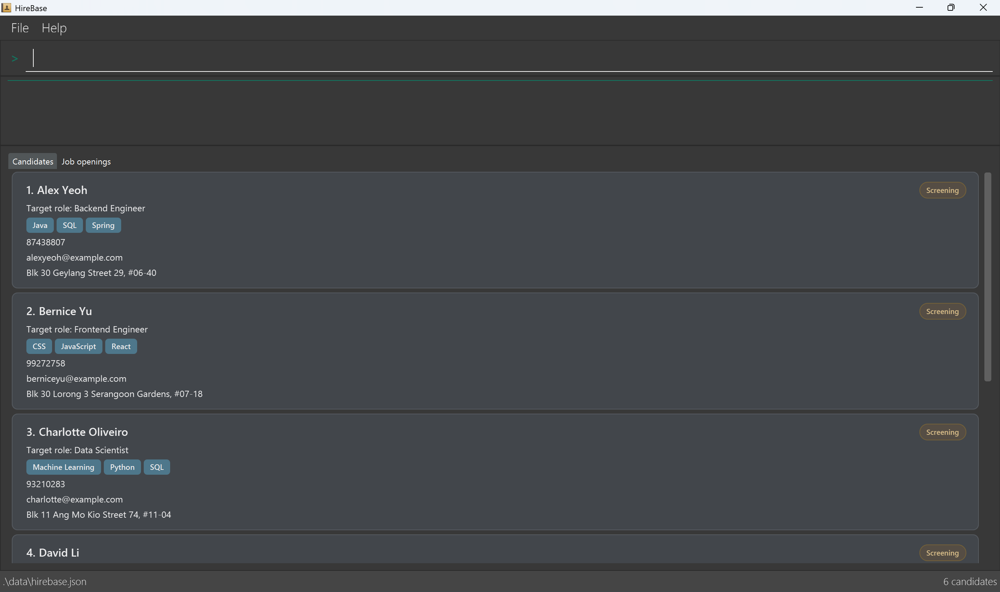

HireBase is a **keyboard-driven CLI application** that helps you manage candidates, their recruitment details, and local job openings. It is designed to be simple, fast, and efficient, by streamlining the management of high-volume candidate tracking for tech recruiters through an optimized, keyboard-first interface.

- Table of Contents
  {:toc}

---

## Quick start

1. Ensure that Java `25` or later is installed on your computer.<br>
   **Mac users:** Ensure you have the precise JDK version prescribed [here](https://se-education.org/guides/tutorials/javaInstallationMac.html).

1. Download the latest `.jar` file from [here](https://github.com/AY2627S1-CS2103T-T12-1/tp/releases).

1. Copy the file to the folder you want to use as the _home folder_ for your HireBase.

1. Open a terminal, `cd` to the folder containing the JAR file, and run `java -jar hirebase.jar`.<br>
   A GUI similar to the one below should appear in a few seconds. Note how the app contains some sample data.<br>
   

1. Type a command in the command box and press Enter to execute it. For example, type **`help`** and press Enter to open the help window.<br>
   Some example commands you can try:
   - `list candidates` : Lists all candidates.

   - `add job t/Software Engineer d/Engineering desc/Build backend services using Java.` : Records a local job opening.

   - `list jobs` : Shows all job openings and their permanent IDs.

   - `add candidate n/John Doe p/98765432 e/johnd@example.com a/John street, block 123, #01-01 s/Java s/SQL r/Backend Engineer` : Adds a contact named `John Doe` to HireBase.

   - `delete candidate 3` : Deletes the 3rd candidate shown in the current list.

   - `clear` : Deletes all candidates and job openings.

   - `exit` : Exits the app.

1. Refer to the [Features](#features) section below for details of each command.

---

## Features

<div markdown="block" class="alert alert-info">

**:information_source: Notes about the command format:**<br>

- Words in `UPPER_CASE` are the parameters to be supplied by the user.<br>
  For example, in `add n/NAME`, replace `NAME` with a value such as `John Doe`.

- Items in square brackets are optional.<br>
  For example, `n/NAME [t/TAG]` can be used as `n/John Doe t/friend` or as `n/John Doe`.

- Items followed by `…`​ can appear zero or more times.<br>
  For example, `[t/TAG]…​` may be omitted, or written as `t/friend` or `t/friend t/family`.

- Prefixed parameters can be in any order.<br>
  For example, if the command specifies `n/NAME p/PHONE_NUMBER`, `p/PHONE_NUMBER n/NAME` is also acceptable.
  Positional arguments, such as `CANDIDATE_ID [MORE_CANDIDATE_IDS]... STAGE` in
  `stage candidate CANDIDATE_ID [MORE_CANDIDATE_IDS]... STAGE`, must follow the order shown.

- `CANDIDATE_ID [MORE_CANDIDATE_IDS]...` means one or more permanent candidate IDs separated by spaces.
  For example, `accept candidate 1` and `accept candidate 1 3 5` are both valid formats.

- `help`, `exit`, `clear`, and `list candidates` ignore extra arguments. For example, `help 123` is interpreted as `help`.<br>
  `list jobs` rejects extra arguments; `list jobs 2` is not valid.

- If you are using a PDF version of this document, be careful when copying and pasting commands that span multiple lines as space characters surrounding line-breaks may be omitted when copied over to the application.
</div>

### Viewing help: `help`

Shows a message explaining how to access the help page.


Format: `help`

### Adding a candidate: `add candidate`

Adds a candidate to HireBase.

Format: `add candidate n/NAME p/PHONE e/EMAIL a/ADDRESS s/SKILL [s/MORE_SKILLS]... r/ROLE`

* A candidate must have at least one skill (`s/`) and exactly one target role (`r/`).
* A skill is 1 to 30 characters long and may contain letters, digits, spaces and `+ # . /`. Repeating `s/` adds more skills; duplicates that differ only in letter case are merged.
* A role is 1 to 100 characters long and may contain letters, digits, spaces, hyphens and slashes.
* Candidates are identified by email. A candidate whose email matches an existing one (ignoring case) cannot be added.

<div markdown="span" class="alert alert-warning">:exclamation: **Caution:**
Tags (`t/`) are not accepted by `add candidate`. Including one shows the usage message.
</div>

Examples:

* `add candidate n/John Doe p/98765432 e/johnd@example.com a/John street, block 123, #01-01 s/Java s/SQL r/Backend Engineer`
* `add candidate n/Betsy Crowe e/betsycrowe@example.com a/Newgate Prison p/1234567 s/C++ s/Python r/Full-Stack Developer`

### Listing all candidates: `list candidates`

Selects the Candidates tab and shows all candidates in HireBase, clearing any active candidate search.

Format: `list candidates`

Use `list jobs` to view openings instead. The bare command `list` is not accepted.

### Managing job openings

Use job openings to keep a local record of roles you are recruiting for. Each opening has a title, department,
description, and optional required skills. The supported commands are [`add job`](#adding-a-job-opening-add-job),
[`list jobs`](#listing-job-openings-list-jobs), [`edit job`](#editing-a-job-opening-edit-job), and [`delete job`](#deleting-a-job-opening-delete-job).
They do not publish vacancies or accept applications.

Job openings and candidate profiles are separate records. Adding, editing or deleting an opening does not assign candidates
to it or change their target roles. When you add an opening with required skills, HireBase can surface previously rejected
candidates with at least one matching skill as an initial shortlist. Use `list candidates` to clear that filter. Use
`edit job` to correct an opening while keeping its ID and position in the job list.

### Switching between candidates and job openings

Click **Candidates** or **Job openings** above the list to switch views. Switching tabs does not change records
or reset a candidate search. You can also use `list jobs` or `list candidates` from the command box;
`list candidates` resets the candidate filter to show all candidates.

Each job card displays its permanent positive-integer ID, title, department, full description, and required skills.
Long details wrap
across lines; scroll the list to read additional content. An empty jobs tab shows `No job openings found.`
Cards update after adding, editing, deleting or clearing records. After a deletion, all remaining openings keep their IDs.

Successful job commands select the Job openings tab. Successful candidate commands, including `find`, select
the Candidates tab. Failed commands keep the current tab and displayed data unchanged. `clear` keeps the active
tab and empties both lists. On launch, the Candidates tab is selected; saved openings are available in Job openings.

### Adding a job opening: `add job`

Records an opening locally; it does not publish a vacancy externally or accept applications.

Format: `add job t/TITLE d/DEPARTMENT desc/DESCRIPTION [s/SKILL]...`

Example: `add job t/Software Engineer d/Engineering desc/Build backend services using Java.`

The `t/`, `d/` and `desc/` prefixes are required exactly once and may appear in any order. Optional `s/` fields
may be repeated, once per required skill. Command words and prefixes are
case-sensitive. Multiple spaces between command words are accepted. Missing or empty required fields, repeated non-skill fields, unknown
parameters, and unexpected text before the first parameter, are rejected without changing records.
A prefix token such as `d/` following whitespace starts a new parameter and cannot be included literally in a value.
This also applies to unknown prefixes: `desc/Build CI/CD pipelines` is rejected as `Unknown parameter: CI/.`.
Use `desc/Build continuous integration and delivery pipelines` instead, or start the value with `desc/CI/CD pipelines`.
Slashes within a value without a preceding space, such as `t/Data/ML Engineer`, are accepted.

Titles and departments accept 1–100 Unicode characters: letters, digits, spaces and `& / ( ) + # . , ' ’ -`.
Each must contain at least one letter or digit. Surrounding whitespace is trimmed and repeated internal whitespace
is collapsed. Descriptions accept 1–2000 printable Unicode characters on one line, with at least one non-whitespace
character. Tabs, line breaks and control characters are rejected. Surrounding spaces are trimmed, internal spaces
are preserved, and length limits apply after normalization. Capitalization is preserved for display.

Add required skills with repeated `s/` fields, for example:
`add job t/Software Engineer d/Engineering desc/Build services s/Java s/SQL`.
Omitting `s/` creates an opening with no required skills. An empty `s/` is rejected when adding.
Skills follow the same rules as candidate skills: 1–30 characters after trimming and collapsing whitespace,
using letters, digits, spaces and `+ # . /`. Skills are compared without regard to case, so `s/Java s/java`
stores one tag. Use `s/Machine Learning` for a multi-word skill and `s/C++ s/C#` for separate skills.
As with other job values, a prefix-like token following whitespace starts a new parameter; `s/CI/CD` is accepted,
while `s/Build CI/CD` is rejected because `CI/` is read as a parameter.

When an opening has required skills, adding it selects the Candidates tab and filters the list to candidates whose
interview stage is `REJECTED` and who have at least one skill matching any of the opening's required skills,
ignoring letter case. For example, a candidate with `Java` is shortlisted for a job requiring `java` and `SQL`.
The command reports how many candidates matched, or that none matched. This shortlist is only a display filter:
it does not change candidate records or assign them to the opening. Use `list candidates` to clear the filter and
show all candidates. Adding an opening without required skills continues to select the Job openings tab.

An opening is a duplicate if both its title and department match an existing opening after normalization,
ignoring case. Descriptions and required skills do not determine uniqueness. The same title in a different department is allowed.
For example, after adding `Software Engineer` in `Engineering`, adding `software engineer` in `ENGINEERING`
is rejected even with a different description. Adding `Software Engineer` in `Research` is accepted.
Multiple vacancies with the same title and department share one opening under this rule.

Success shows `Added job opening ID: TITLE — DEPARTMENT.` IDs start at 1 and increase for each new
opening. They remain unchanged after deletion of other openings, and across restarts. Deleted IDs are never reused,
even after `clear`. Job IDs and candidate IDs are separate; the same number can identify one record of each type.
A duplicate reports the existing opening's ID, title and department and is not added. The opening is saved before success is reported. If saving fails,
HireBase reports `Could not save changes. Job opening was not added. Check storage permissions and available disk space, then try again.`
and leaves existing records and the candidate display unchanged.

Use `list jobs` to view saved openings. The opening is retained in the local data file across launches.
Successful job commands select the Job openings tab automatically, except that `add job` with required skills selects
the Candidates tab to show the matching rejected-candidate shortlist. If all IDs through 2147483647 have been
allocated, further additions are rejected with `No more job IDs are available.`; existing openings remain usable.

Common input errors (none adds an opening):

| Input problem | Example | Feedback |
| --- | --- | --- |
| Missing description | `add job t/Engineer d/Engineering` | `Missing required parameter: desc/. Usage: add job t/TITLE d/DEPARTMENT desc/DESCRIPTION [s/SKILL]...` |
| Empty title | `add job t/ d/Engineering desc/Build services` | `Parameter t/ cannot be empty.` |
| Repeated department | `add job t/Engineer d/Engineering d/Research desc/Build services` | `Parameter d/ must be specified only once.` |
| Unknown prefix | `add job t/Engineer d/Engineering desc/Build services salary/5000` | `Unknown parameter: salary/.` |
| Text before the fields | `add job Engineer t/Engineer d/Engineering desc/Build services` | `Unexpected text: Engineer. Usage: add job t/TITLE d/DEPARTMENT desc/DESCRIPTION [s/SKILL]...` |

Invalid title, department or description values produce a field-specific validation message. Correct the input
and submit the command again. For a duplicate at ID 1, feedback is
`Job opening already exists (1): Software Engineer — Engineering. Job opening was not added.`

### Listing job openings: `list jobs`

Format: `list jobs`

Selects the Job openings tab and displays all stored openings as cards in creation order (earliest first).
The command result area also includes their full details. Required skills are displayed alphabetically,
ignoring case, or as `Required skills: None` when no tags are set.
Each entry shows its permanent positive-integer ID, title, department, full description, and required skills. Openings with the same title
in different departments are displayed separately. The number identifies the opening, even if it is no longer
at that list position. Gaps are expected after deletions.

The result starts with `Listed N job openings.` (or `Listed 1 job opening.` for a single opening).
An empty list is a successful result: `No job openings found.`

Example result after adding a Software Engineer opening:

```text
Listed 1 job opening.

1. Software Engineer — Engineering
Description: Build backend services using Java.
Required skills: None
```

The command is case-sensitive and accepts no parameters. Surrounding whitespace and multiple spaces between
`list` and `jobs` are accepted. Extra arguments, such as `list jobs 2`, are rejected with
`The list jobs command does not accept parameters. Usage: list jobs`. Use the plural `jobs`; `list job` is not valid.

Listing jobs does not change records, their order, the candidate list or its active filter, and does not rewrite
the data file.

### Editing a job opening: `edit job`

Format: `edit job ID [t/TITLE] [d/DEPARTMENT] [desc/DESCRIPTION] [s/SKILL]...`

Example: `edit job 1 t/Senior Software Engineer desc/Lead backend development.`

Use `list jobs` to check the permanent ID. The ID must be a positive integer referring to an existing
opening; candidate filters do not affect job IDs. The ID is independent of list position: after deleting job 1,
`edit job 2 d/Research` still edits job 2 even if it is now the first card. Deleted IDs are rejected.
The keywords `edit` and `job` are case-sensitive.
Provide at least one field, in any order. Omitted fields retain their values. Supplied titles, departments and descriptions must be non-empty
and follow the same validation rules as [`add job`](#adding-a-job-opening-add-job). Repeated non-skill prefixes and unknown prefixes
are rejected. An edit that would duplicate another opening's title and department (ignoring case) is rejected.
Changing only capitalisation or supplying the existing values is allowed.

To tag an existing opening, use `edit job 2 s/Java s/SQL`. Supplied skills **replace the entire required-skill set**;
include every skill you want to keep. Omitting `s/` preserves existing skills, including when editing the title,
department or description. A single empty `s/`, as in `edit job 2 s/`, clears all skills. Combining an empty `s/`
with other `s/` fields is rejected. Skills use the same validation and duplicate rules as `add job`.
Tagging skills preserves the opening's ID and does not change candidate skills or filter candidates automatically.

Success shows `Edited job opening ID: TITLE — DEPARTMENT.` and selects the Job openings tab. The opening
keeps its ID and list position; other openings, candidate records and candidate filters remain unchanged.
Changes persist across launches. If saving fails, the live opening remains unchanged and HireBase reports
`Could not save changes. Job opening was not edited. Check storage permissions and available disk space, then try again.`

For example, `edit job 1 d/Research` changes only the department. `edit job 1` is rejected because no fields were
specified, and `edit job 1 desc/` is rejected because descriptions cannot be empty. An unavailable ID reports
`Job ID "ID" does not exist. Use list jobs to view available job IDs.`

### Deleting a job opening: `delete job`

Format: `delete job ID`

Example: `delete job 2` deletes the opening with ID 2, regardless of its position in `list jobs`.
The ID must be a positive integer referring to an existing opening in the current job list.
Use `list jobs` before deleting to check the ID. After deletion, remaining openings retain their IDs.
Candidate filters do not affect job IDs. A deleted ID is rejected even if another opening occupies its old position.

The command accepts exactly one ID. `job` is a required, case-sensitive keyword.
Surrounding whitespace and multiple spaces between command words are accepted. Missing, invalid or multiple
IDs are rejected with usage guidance. A nonexistent ID reports
`Job ID "ID" does not exist. Use list jobs to view available job IDs.`

Success shows `Deleted job opening ID: TITLE — DEPARTMENT.` Only that opening is removed; other openings,
candidate records, target roles and the active candidate filter remain unchanged. An opening with the same title
and department can then be added again with a new ID and is appended to the end of the list.

The deletion is saved before being applied to the live job list. If saving fails, the opening is retained and
HireBase reports `Could not save changes. Job opening was not deleted. Check storage permissions and available disk space, then try again.`
Successful deletion selects the Job openings tab and refreshes its cards.

Common deletion errors:

| Command | Feedback |
| --- | --- |
| `delete job` | `Missing job ID. Usage: delete job ID` |
| `delete job 1 2` | `Expected exactly one job ID. Usage: delete job ID` |
| `delete job 0` | `Job ID must be a positive integer. Usage: delete job ID` |
| `delete job 1.5` | `Job ID must be a positive integer. Usage: delete job ID` |

Negative IDs, non-numeric values and integers above 2147483647 are also rejected. A syntactically valid ID
must still refer to an existing opening; use `list jobs` to check the current list after an error.

### Example: create, review and close an opening

The following example assumes no jobs have ever been added to this data file. Otherwise, use the IDs
reported by your own `list jobs` result instead of the example IDs, even if the list is currently empty.
Do not use `clear` to prepare this example: it deletes candidate records as well as openings.

Run `add job t/Software Engineer d/Engineering desc/Build backend services using Java.`. HireBase reports
`Added job opening 1: Software Engineer — Engineering.` and selects the Job openings tab.
Then run `add job t/Data Analyst d/Analytics desc/Analyse business data using SQL.`. This opening receives ID 2.
`list jobs` now shows both cards and reports `Listed 2 job openings.`

When the Software Engineer opening closes, run `delete job 1`. HireBase reports
`Deleted job opening 1: Software Engineer — Engineering.`. Run `list jobs` again: Data Analyst still has ID 2.
Adding another opening gives it ID 3. Candidate records and their target roles are unchanged.
Restarting HireBase retains the remaining opening; click Job openings or run `list jobs` to see it again.

### Editing a candidate: `edit candidate`

Updates the candidate at the positive `INDEX` shown in the current list, including a list narrowed by `find`.
After a successful edit, the full list is displayed again.

Format: `edit candidate INDEX [n/NAME] [e/EMAIL] [p/PHONE] [s/SKILL]… [r/ROLE] [a/ADDRESS] [t/TAG]…`

`candidate` is a required, case-sensitive keyword. The old `edit INDEX ...` syntax is rejected.
Multiple spaces between command words are accepted.

Supply at least one field. Omitted fields retain their existing values. Supplying `s/` replaces the entire skill set;
repeat it to supply multiple skills. Skills are optional: use `edit candidate INDEX s/` to clear them.
When supplying multiple skills, each value must be non-blank.
Repeated skills are combined without regard to case. A repeated single-value prefix such as `r/` is rejected.

For example, `edit candidate 1 s/` removes all skills from the first displayed candidate. Mixing an empty skill with a
non-empty skill, as in `edit candidate 1 s/ s/new skill`, is rejected and leaves the candidate's entire record unchanged.
To replace all existing skills with just "new skill", use `edit candidate 1 s/new skill`.
Omitting `s/` entirely preserves the candidate's existing skills.

Names accept 1–100 characters consisting of letters, spaces, hyphens and apostrophes. Phone numbers accept 3–15 digits,
with an optional leading `+`. Emails must have a valid email format and must not match another candidate's email,
ignoring case. Candidates may share the same name. Changing only the case of a candidate's own email is allowed.

Skills accept 1–30 characters consisting of letters, digits, spaces and `+`, `#`, `.`, `/`.
Target roles accept 1–100 characters consisting of letters, digits, spaces, hyphens and slashes, and cannot be blank.
Leading and trailing whitespace is trimmed, and consecutive whitespace in names, skills and roles is collapsed.
Invalid input leaves the records unchanged.

For example, `edit candidate 1 p/+6591234567 e/johndoe@example.com` updates only the first displayed candidate's contact details.
`edit candidate 2 s/Java s/SQL r/Backend Engineer` replaces the second displayed candidate's skills and target role,
preserving their contact details and remark. Editing a remark also preserves skills and target role.
Edited recruitment details appear on the candidate card and are saved locally.
Older records without skills or a target role can still be loaded and edited.

The existing address and tag fields remain supported. Supplying tags replaces the entire tag set;
`t/` with no value clears tags.

### Searching candidates by name or email: `find`

Finds candidates whose names or email addresses match any of the given keywords.

Format: `find KEYWORD [MORE_KEYWORDS]`

- Matching is case-insensitive for both names and email addresses.
- Names match whole words: `Hans` matches `Hans Gruber`, but `Han` does not match his name.
- Email addresses match any substring: `hans`, `hans@example.com`, and `@example.com` all match `hans@example.com`.
  A partial name keyword can still find a candidate if it matches their email address.
- Keywords are separated by whitespace. Supply at least one keyword; an empty search is rejected.
- A candidate is returned if any keyword matches their name or email address (an `OR` search).
  Keyword order does not matter, and a candidate matching several keywords appears only once.
- Results retain the candidate list's order and use the displayed indexes for subsequent edit or delete commands.
- Each search considers all candidates, including those hidden by a previous search.
  Use `list candidates` to display all candidates again.
- The search considers only names and email addresses; it does not search skills, roles, remarks, or other fields.

Examples:

- `find John` finds candidates with the whole name word `John` or `john` anywhere in their email address.
- `find JOHND@EXAMPLE.COM` finds candidates whose email address contains `johnd@example.com`, ignoring case.
- `find @example.com` finds candidates with `@example.com` anywhere in their email address.
- `find Alex johnd@example.com` finds candidates matching either the name word `Alex` or the email substring
  `johnd@example.com`.

### Deleting a candidate: `delete candidate`

Deletes the specified candidate from HireBase.

Format: `delete candidate INDEX`

- The `candidate` record-type keyword is required and case-sensitive.
- Deletes the candidate at the specified `INDEX`.
- The index refers to the index number shown in the displayed candidate list.
- The index **must be a positive integer** 1, 2, 3, …​

Examples:

- `list candidates` followed by `delete candidate 2` deletes the 2nd candidate in HireBase.
- `find Betsy` followed by `delete candidate 1` deletes the 1st candidate in the results of the `find` command.

### Viewing a candidate's full details: `view candidate`

Shows the full details of one candidate in the result display and collapses the candidate list to only that candidate.

Format: `view candidate CANDIDATE_ID`

- The `candidate` record-type keyword is required and case-sensitive.
- `CANDIDATE_ID` is the candidate's **permanent ID**, shown on each card as `#N` (for example, `#1`) before their name. It never changes when the list is
  filtered, reordered, or when other candidates are deleted.
- Because the ID is permanent, you can view any candidate by their ID even while a `find` filter is hiding them.
- `CANDIDATE_ID` **must be a positive integer** 1, 2, 3, …​ Surrounding and repeated whitespace is accepted.
- The result display lists the candidate's name, interview stage, phone, email, address, target role, skills, and note.
  Empty optional fields (role, skills, note) are shown as `—`.
- A `CANDIDATE_ID` that no candidate has is rejected with
  `Candidate ID "<ID>" does not exist. Use list to view available candidate IDs.`, leaving the list unchanged.

Examples:

- `view candidate 1` shows the full details of the candidate whose ID is `1` and collapses the list to that candidate.
- `find Betsy` followed by `view candidate 3` still shows candidate `3` even if the search filtered them out.

Sample feedback:

| Command | Feedback |
| --- | --- |
| `view candidate 1` | Candidate `1`'s full details (name, stage, phone, email, address, role, skills, note); the list collapses to that candidate. |
| `view candidate 999` | `Candidate ID "999" does not exist. Use list to view available candidate IDs.` |
| `view candidate 0`, `view candidate abc` | `Invalid command format!` followed by the `view candidate` usage (the ID must be a positive integer). |
| `view 1`, `view person 1` | `Invalid command format!` followed by the `view candidate` usage (the `candidate` keyword is required). |

### Adding or updating a candidate's note: `note`

Adds, updates, or clears the free-text screening note of an existing candidate. Any existing note is overwritten.

Format: `note CANDIDATE_ID [NOTE]`

- `CANDIDATE_ID` is the candidate's **permanent ID** (shown on the card as `#N`, e.g. `#1`), the same ID used by `view candidate`.
  It **must be a positive integer**.
- The note replaces any existing note. **Omit `NOTE` to clear** the candidate's note.
- Leading and trailing whitespace is trimmed; spacing and punctuation inside the note are preserved. The note is plain
  text — there is no prefix to type.
- After a successful note, HireBase shows the full candidate list again. The command works even while a `find` filter
  is active, because the candidate is located by ID.
- Only the note changes; the candidate's name, contact details, skills, role, and interview stage are preserved.
- A `CANDIDATE_ID` that no candidate has is rejected with
  `Candidate ID "<ID>" does not exist. Use list to view available candidate IDs.`

Examples:

- `note 1 Strong system-design round; follow up re: availability` sets the note on candidate `1`; HireBase replies
  `Added note to candidate: …`.
- `note 1` clears candidate `1`'s note; HireBase replies `Removed note from candidate: …`.

Sample feedback:

| Command | Feedback |
| --- | --- |
| `note 1 Strong SQL round` | `Added note to candidate: ` followed by candidate `1`'s updated details. |
| `note 1` | `Removed note from candidate: ` followed by candidate `1`'s updated details. |
| `note 999 Strong SQL round` | `Candidate ID "999" does not exist. Use list to view available candidate IDs.` |
| `note 0 x`, `note abc x`, `note` | `Invalid command format!` followed by the `note` usage (the ID must be a positive integer). |

### Changing candidates' interview stages: `stage candidate`

Changes the interview stage of one or more specified candidates. New candidates start at `SCREENING`.
The candidate card shows the current stage as **Screening**, **Accepted**, or **Rejected**.

Format: `stage candidate CANDIDATE_ID [MORE_CANDIDATE_IDS]... STAGE`

- `stage` and the required `candidate` keyword are case-sensitive.
- Each ID must be a positive integer matching a candidate's permanent `CANDIDATE_ID` shown on their card.
  IDs stay the same after filtering or deleting other candidates. Candidates hidden by `find` can also be updated.
- `STAGE` must be `SCREENING`, `ACCEPTED`, or `REJECTED`. Stage names are case-insensitive;
  for example, `accepted` and `ACCEPTED` have the same effect.
- Supply one or more IDs followed by one stage, which is applied to every selected candidate.
  There is no fixed limit on the number of IDs. Repeated IDs update the candidate only once,
  in the order the IDs first appear.
- All IDs are checked against all candidates before any updates. If any ID is invalid or does not exist,
  no candidates are changed. Missing arguments and unknown stages are also rejected without changing records.
- Surrounding whitespace and multiple spaces between arguments are accepted.
- You can move a candidate from any stage to any other stage, including back to `SCREENING`.
  Setting the current stage again is also allowed.

Successful `stage`, `accept`, and `reject` commands change only the interview stage, preserving all other candidate
information, including notes and permanent candidate IDs. They select the Candidates tab, show the full candidate
list again, and update the stage on each selected candidate's card.
The search filter is cleared after success; permanent candidate IDs remain unchanged.
The stage is saved automatically and restored when you reopen HireBase. Editing a candidate or their notes
preserves the stage.

Success shows `Updated interview stage for candidate CANDIDATE_ID: NAME (EMAIL) to STAGE` for each selected candidate,
on a separate line. Single-candidate commands show one line.
A nonexistent or deleted ID reports `Candidate ID "CANDIDATE_ID" does not exist. Use list to view available candidate IDs.`
An unknown stage reports `Interview stage must be one of [SCREENING, ACCEPTED, REJECTED] (case-insensitive).`

Examples:

- `stage candidate 1 ACCEPTED` sets the stage of the candidate with ID 1 to `ACCEPTED`.
- `stage candidate 2 screening` returns the candidate with ID 2 to `SCREENING`.
- `stage candidate 1 3 5 ACCEPTED` accepts candidates with IDs 1, 3, and 5.
- `stage candidate 2 1 2 REJECTED` rejects candidates with IDs 2 and 1, updating each only once.
- After `find Betsy`, `stage candidate 1 rejected` still rejects the candidate with ID 1,
  even if they are hidden by the search, then shows the full candidate list.

If ID 4 does not exist, `stage candidate 1 4 ACCEPTED` reports the missing ID and changes no records, including ID 1.

### Accepting candidates: `accept candidate`

Marks one or more specified candidates as accepted by setting their stage to `ACCEPTED`.
This is a shortcut for `stage candidate CANDIDATE_ID [MORE_CANDIDATE_IDS]... ACCEPTED`.

Format: `accept candidate CANDIDATE_ID [MORE_CANDIDATE_IDS]...`

`accept` and the required `candidate` keyword are case-sensitive. Supply one or more positive permanent candidate IDs,
including IDs of candidates hidden by a search. Do not add a stage argument: `accept candidate 1 ACCEPTED`
is invalid. Surrounding whitespace and multiple spaces between arguments are accepted.
Every ID is checked against all candidates before any updates. Repeated IDs update each candidate once.
Missing IDs, non-ID arguments, invalid IDs, and nonexistent or deleted IDs leave all records unchanged.

Examples: `accept candidate 1` accepts the candidate with ID 1; `accept candidate 1 3 5` accepts candidates with
IDs 1, 3, and 5. The command shows the full candidate list again and uses the same success
message as `stage candidate` for each selected candidate, ending in `to ACCEPTED`.
Candidates stay in HireBase; accepting already accepted candidates is allowed, and their stages can be changed later.

### Rejecting candidates: `reject candidate`

Marks one or more specified candidates as rejected by setting their stage to `REJECTED`.
This is a shortcut for `stage candidate CANDIDATE_ID [MORE_CANDIDATE_IDS]... REJECTED`.

Format: `reject candidate CANDIDATE_ID [MORE_CANDIDATE_IDS]...`

`reject` and the required `candidate` keyword are case-sensitive. Supply one or more positive permanent candidate IDs,
including IDs of candidates hidden by a search. Do not add a stage argument: `reject candidate 1 REJECTED`
is invalid. Surrounding whitespace and multiple spaces between arguments are accepted.
Every ID is checked against all candidates before any updates. Repeated IDs update each candidate once.
Missing IDs, non-ID arguments, invalid IDs, and nonexistent or deleted IDs leave all records unchanged.

Examples: `reject candidate 1` rejects the candidate with ID 1; `reject candidate 1 3 5` rejects candidates with
IDs 1, 3, and 5. The command shows the full candidate list again and uses the same success
message as `stage candidate` for each selected candidate, ending in `to REJECTED`.
Candidates stay in HireBase; rejecting already rejected candidates is allowed, and their stages can be changed later.

### Clearing all entries: `clear`

Clears all candidates and job openings from HireBase.

Format: `clear`

### Exiting the program: `exit`

Exits the program.

Format: `exit`

### Saving the data

HireBase automatically saves data after commands, except the read-only `list jobs` command. You do not need to save manually.
Candidate records and any stored job openings are saved together in the same data
file and loaded on the next launch.
Older data files without a `jobs` field still load normally, with an empty job-opening list.

### Editing the data file

HireBase data is saved automatically as a JSON file `[JAR file location]/data/hirebase.json`. Advanced users are welcome to update data directly by editing that data file.

Each candidate's `interviewStage` must be `SCREENING`, `ACCEPTED`, or `REJECTED` in the JSON file (case-sensitive).
Older records without this field, or with a `null` value, load as `SCREENING`.
Blank strings, unknown stage names, or incorrect capitalization make the data file invalid.

The `jobs` array stores each opening's `id`, `title`, `department`, `description`, and `skills`, preserving job order.
`skills` is an array of strings, for example `["Java", "SQL"]`. Older openings with no `skills` field, or a null
field, load with no required skills. Invalid skill values, non-string entries, or a non-array field make the file
invalid; duplicate skill strings are combined ignoring case. Skills are saved across restarts.
Job IDs must be unique positive integers from 1 to 2147483647. The top-level `nextJobId` counter preserves the
next unused ID, including after deletion or `clear`; do not lower it or change assigned IDs manually.
Older openings with no ID (or a null ID) receive IDs in file order, starting above all stored IDs and at least as high as the saved
counter. If no IDs or counter exist, numbering starts at 1. These assigned IDs are saved on the next successful
command that writes data; `list jobs` alone does not rewrite the file. A missing counter is reconstructed from
stored IDs. A counter below an existing ID is advanced automatically. Invalid or duplicate IDs make the file
invalid. The counter accepts 1 through 2147483648; the final value indicates that no new IDs are available.
Each opening must have all three fields and satisfy the job model's validation rules: titles and departments are
1–100 characters using letters, digits, spaces, or `& / ( ) + # . , ' ’ -`, with at least one letter or digit;
descriptions are 1–2000 printable characters on one line. Title and department whitespace is collapsed,
while internal spaces in descriptions are preserved. Length limits apply after trimming and normalization.
Openings with the same title and department, ignoring case and normalized whitespace, are duplicates even if their
descriptions differ. Invalid or duplicate openings cause the data file to fail loading; they are not silently skipped.
Use `add job` to create openings and `list jobs` to view their cards and full details.

<div markdown="span" class="alert alert-warning">:exclamation: **Caution:**
If your changes make the data file invalid, HireBase starts with empty candidate and job-opening lists at the next run. The invalid file remains on disk until you run a command that saves data (`list jobs` does not save). Still, we recommend backing up the file before editing it.<br>
Furthermore, certain edits can cause the HireBase to behave in unexpected ways (e.g., if a value entered is outside of the acceptable range). Therefore, edit the data file only if you are confident that you can update it correctly.
</div>

### Archiving data files `[coming in v2.0]`

_Details coming soon ..._

---

## FAQ

**Q**: How do I transfer my data to another computer?<br>
**A**: Install the app on the other computer and overwrite the data file it creates with the data file from your previous HireBase home folder.

---

## Known issues

1. **When using multiple screens**, if you move the application to a secondary screen, and later switch to using only the primary screen, the GUI will open off-screen. The remedy is to delete the `preferences.json` file created by the application before running the application again.
2. **If you minimize the Help Window** and then run the `help` command (or use the `Help` menu, or the keyboard shortcut `F1`) again, the original Help Window will remain minimized, and no new Help Window will appear. The remedy is to manually restore the minimized Help Window.

---

## Command summary

| Action | Format, Examples |
|--------|------------------|
| **Add candidate** | `add candidate n/NAME p/PHONE e/EMAIL a/ADDRESS s/SKILL [s/MORE_SKILLS]... r/ROLE`<br> e.g., `add candidate n/Amy p/91234567 e/amy@example.com a/Blk 1 s/Java s/SQL r/Backend Engineer` |
| **List candidates** | `list candidates` |
| **Find candidates** | `find KEYWORD [MORE_KEYWORDS]` (searches names or emails)<br> e.g., `find James james@example.com` |
| **Edit candidate** | `edit candidate INDEX [n/NAME] [e/EMAIL] [p/PHONE] [s/SKILL]… [r/ROLE] [a/ADDRESS] [t/TAG]…`<br> e.g., `edit candidate 2 n/James Lee e/jameslee@example.com` |
| **Change interview stage** | `stage candidate CANDIDATE_ID [MORE_CANDIDATE_IDS]... STAGE`<br> e.g., `stage candidate 1 3 ACCEPTED` |
| **Accept candidates** | `accept candidate CANDIDATE_ID [MORE_CANDIDATE_IDS]...`<br> e.g., `accept candidate 1 3` |
| **Reject candidates** | `reject candidate CANDIDATE_ID [MORE_CANDIDATE_IDS]...`<br> e.g., `reject candidate 2 4` |
| **Delete candidate** | `delete candidate INDEX`<br> e.g., `delete candidate 3` |
| **View candidate** | `view candidate CANDIDATE_ID`<br> e.g., `view candidate 1` |
| **Note candidate** | `note CANDIDATE_ID [NOTE]`<br> e.g., `note 1 Strong system-design round` |
| **Add job** | `add job t/TITLE d/DEPARTMENT desc/DESCRIPTION [s/SKILL]...`<br> e.g., `add job t/Software Engineer d/Engineering desc/Build Java services.` |
| **List jobs** | `list jobs` |
| **Edit job** | `edit job ID [t/TITLE] [d/DEPARTMENT] [desc/DESCRIPTION] [s/SKILL]...`<br> e.g., `edit job 1 d/Research` |
| **Delete job** | `delete job ID`<br> e.g., `delete job 2` |
| **Clear** | `clear` |
| **Help** | `help` |
| **Exit** | `exit` |
